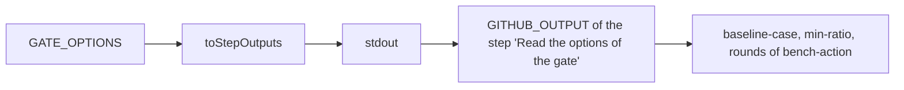

# gate-options.mjs

## What it does

`node bench/bin/gate-options.mjs` prints how the benchmark gate judges a run, `GATE_OPTIONS` of
`bench/gate/baseline.ts`, as the outputs of a step: `baseline-case=previous`, `min-ratio=80` and
`rounds=5`, one a line (`toStepOutputs` of `bench/src/gateOptions.ts`).

## Why it exists

The `bench` job of `.github/workflows/ci.yml` gives those values to `soroush-tech/bench-action`, and
`pnpm bench:gate` gives them to the CLI. A workflow cannot import a TypeScript constant, so a step runs this
script and appends what it prints to `$GITHUB_OUTPUT`; the inputs of the action read the outputs of that
step. Both places then read one constant.

## The logic

## What it guarantees

- It prints the three lines and nothing else, so the step's outputs are exactly those three.
- It reads nothing but the constant: no network, no Docker.

## Limits

- It has no test of its own: what it prints is `toStepOutputs`, tested in `bench/src/gateOptions.test.ts`.
