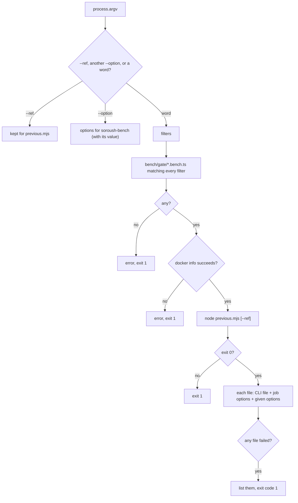

# gate.mjs

## What it does

`pnpm bench:gate [--ref <git ref>] [filter ...] [soroush-bench option ...]` runs the benchmark gate on a
machine as the `bench` job of `.github/workflows/ci.yml` runs it. The root `package.json` runs
`pnpm build` first, then this script, which:

1. lists `bench/gate/*.bench.ts`, keeping those whose name contains every filter word;
2. stops when no file matches or Docker is not running;
3. runs `bench/bin/previous.mjs` (with `--ref` when it was given), which builds the last release in
   `.bench-previous/`;
4. runs each file with the soroush-bench CLI, one after the other, with the job's options
   (`GATE_OPTIONS` of `bench/gate/baseline.ts`, which the job reads too: `--baseline-case previous
   --min-ratio 80 --rounds 5`) and then the options given, which win;
5. exits 1 when any file failed, after running them all.

## Why it exists

The gate has to be something a developer can run before pushing, and see fail the same way CI does. The
job uses `soroush-tech/bench-action`; this uses the CLI of the same package (`@soroush.tech/bench`, the
version in `bench/package.json`) with the same three inputs, on the same files, after the same previous
build.

## The logic

## What it guarantees

- The files run one at a time, so that no two measure each other.
- The job's inputs come first and the given options after, so `--rounds 1` (a quick look) overrides the
  five rounds of the job.
- No file runs against a missing or stale previous build: `previous.mjs` runs first, and stops the script
  when it fails.

## Decisions

- **The job's options are read, not written here.** `GATE_OPTIONS` (`bench/gate/baseline.ts`) is the one
  place; this script turns it into the options of the CLI (`toCliArguments`, `bench/src/gateOptions.ts`),
  and the job prints it as the outputs of a step (`bench/bin/gate-options.mjs`) that it gives the action.

- **A script of its own, not a flag of `local.mjs`.** The local files and the gate files differ in where
  they are, what they need (the gate needs the previous build, the local files a second mount for the
  `node_modules` links) and how they are judged (the gate has a baseline case and a ratio).
- **No second mount.** The gate files load nothing from `node_modules`: the two builds of the core have no
  dependency at run time.

## Limits

- The action of the job vendors its own copy of soroush-bench (2.4.0 at the pinned commit of 1.3.0), and
  the workspace has 2.4.0 too: the gate's rule is the same in both (`baseline.avg / case.avg` against the
  minimum ratio), and both name the bench version, Node version and sandbox limits of the run (the tool in
  a line before each file's results, the action under the head line of its report). What else is printed
  differs: the action posts a summary table across the files and each file's table under it; this script
  prints the tool's own report for each file.
- It prints what the tool prints and judges by its exit code. The tool's `--json-file` would let it lay out
  a table of its own; that was not done, because the printed report already says which case failed and by
  how much, and an exit code needs no file read back from the sandbox. The action (1.3.0) also fails a file
  that ran but left no results to compare. A gate file cannot do that: it has both of its cases, `current`
  and `previous`, or fails as it loads, and the tool fails on a baseline case that matches no case.
- It has no test; it needs Docker.
