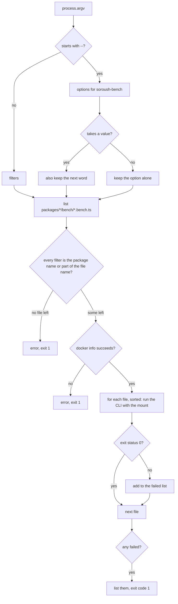

# local.mjs

## What it does

Runs the soroush-bench files of `packages/*/bench/` one after the other, each in the Docker sandbox of
soroush-bench, from the repository root. Arguments that do not start with `--` filter the files; the
`--` options go to soroush-bench unchanged, for every file. It exits 1 when no file matches, when Docker
is not running, or when any file failed (after it has run all of them).

## Why it exists

soroush-bench takes one file at a time, and the local benchmarks live next to what they measure, in each
package. This script finds them, mounts the repository the way the sandbox needs it, and runs them in
sequence. It is the `bench` script of the root `package.json` (`pnpm build && node bench/bin/local.mjs`),
so the files always load a fresh `dist`. The CI gate does not use it: that is `bench/gate/`, run by
`soroush-tech/bench-action` in `.github/workflows/ci.yml`. `pnpm test` never runs it.

## The logic

The CLI of soroush-bench is found through the `bin` entry of its `package.json` in
`bench/node_modules/@soroush.tech/bench` and is run with the current Node, not through a shell. Each
file runs with `cwd` at the repository root and `stdio: 'inherit'`, so its output is the output of the
script. The files are sorted by path, and a file never runs at the same time as another.

## The data

- `VALUE_OPTIONS`: the soroush-bench options that take a value (`--rounds`, `--cpus`, `--cpu`,
  `--cpuset`, `--memory`, `--tag`, `--mount`, `--md-file`, `--json-file`, `--baseline-case`, `--min-ratio`). The word
  after one of them is kept with it and is not read as a filter.
- The mount: `<root>:<linked>:ro`. On Windows `linked` is `/mnt/host/<drive letter>/<rest of the path>`
  (Docker Desktop's view of the drive); elsewhere it is the root itself.

## What it guarantees

- A filter narrows by AND: a file runs only if every filter equals its package folder name or is a
  substring of its file name.
- The repository is mounted read-only.
- One file's failure does not stop the others; the exit code tells that something failed.
- Nothing is run when Docker is down or no file matches.
- A bare `--` is dropped, so `pnpm bench -- core` works.

## Decisions

- One file at a time: the header comment says two at once would measure each other.
- The extra mount exists because pnpm links `node_modules` with absolute paths (junctions on Windows),
  which resolve in the sandbox only when the repository is also at the path they point to.

## Limits

- It has no test; it needs Docker.
- An option with a value written in one word (`--rounds=5`) is kept as one option, which works. A value
  option that is not in `VALUE_OPTIONS` and is followed by a value makes that value a filter.
