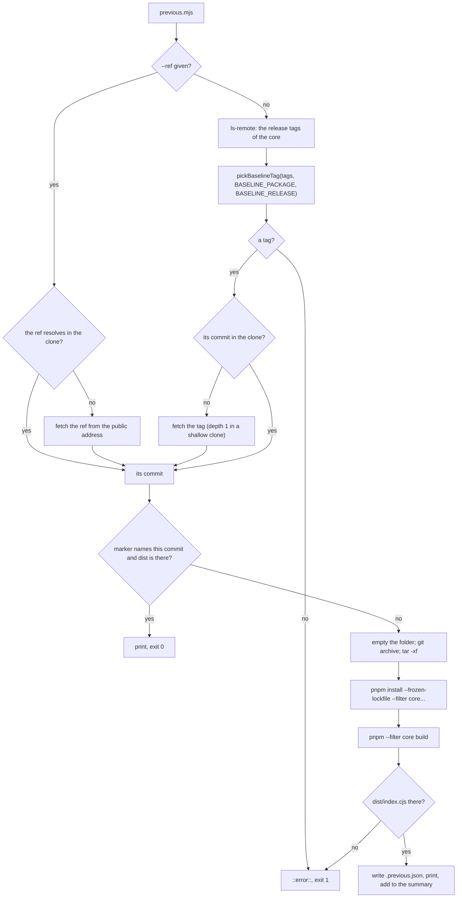

# previous.mjs

## What it does

`node bench/bin/previous.mjs [--ref <git ref>]` makes the `previous` side of the benchmark gate: the core
of the last release, built in `.bench-previous/` (`PREVIOUS_DIR`) at the root of the repository.

1. It finds the release: `git ls-remote --tags` on the public address of the repository (the
   `repository.url` of `packages/core/package.json`, without `git+`), and `pickBaselineTag` with
   `BASELINE_PACKAGE` and `BASELINE_RELEASE` of `bench/gate/baseline.ts`. With `--ref`, the ref given
   (a tag, a branch, a commit id, `HEAD`) is used instead.
2. It makes sure the commit is in the clone: when it is not, it fetches that one ref from the public
   address into `FETCH_HEAD`, with `--depth=1` in a shallow clone (CI's) and with its history in a full
   one.
3. When `.bench-previous/.previous.json` names the same commit and the build is there, it stops: nothing
   to do.
4. Otherwise it empties the folder, writes the commit's tree into it with `git archive` and `tar`,
   installs the core and what it needs with that release's lockfile
   (`pnpm install --frozen-lockfile --ignore-scripts --filter @umber-style/core...`), builds the core with
   that release's own tooling, and writes the marker.
5. It prints the tag and commit, and adds a line to the job summary when there is one.

Any failure stops it with exit code 1 and a `::error::` line.

## Why it exists

The gate compares this tree with the last release, both built the same way and loaded by path from the
mounted repository (`bench/gate/baseline.md` says why). CI's `bench` job runs this script before the
gate, and `bench/bin/gate.mjs` (`pnpm bench:gate`) runs it on a machine, so the two make the same build.

## The logic

## What it guarantees

- No tag, branch, worktree or index entry of the clone changes: a fetch goes to `FETCH_HEAD` only, and
  the tree is written with `git archive`, not checked out. A full clone stays full.
- The build is the one that release made: its own lockfile, its own tsdown config.
- It never leaves a half-built folder marked as built: the marker is written last.
- It needs no credentials: the public address is read anonymously.

## Decisions

- **`git archive` and not `git worktree`**: a worktree is recorded in the clone and must be pruned; an
  archive leaves the clone as it was. The archive is extracted by a relative path, because a `tar` that
  reads `C:\...` as a host and a path (Git for Windows ships one) would fail on an absolute one.
- **A filtered install with the release's lockfile, not the current tree's tooling.** Building the old
  source with today's tooling would mix a change of tooling into the comparison and would need the
  old tree's dependencies resolved from the new one. The filtered install fetches the core's own
  dependencies only (on this machine 246 packages, 4 seconds, from the pnpm store).
- **The public address and not `origin`**: `origin` may be an SSH address with no key in CI or a key a
  machine does not have; the repository is public.

## Limits

- It needs `git`, `tar` and `pnpm` on the path, and the network for `ls-remote` (and for a fetch when
  the commit is missing).
- A release whose core cannot be built by its own lockfile (a registry that has dropped a package) stops
  the gate.
- It has no test of its own; the choice of the tag is tested in `bench/src/releases.test.ts`.
