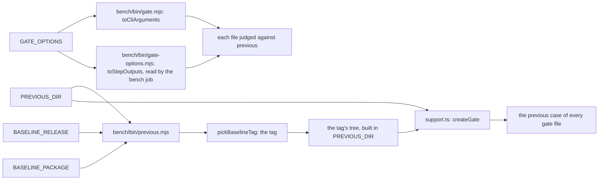

# baseline.ts

## What it does

Says what the benchmark gate compares the current tree with, in three constants, and how it judges a run,
in a fourth:

- `BASELINE_PACKAGE`, `@umber-style/core`: the package whose release tags are chosen from.
- `BASELINE_RELEASE`, `'stable'`: which tag is the last release. `'stable'` is the last stable tag;
  `'newest'` is the newest tag, stable or release candidate (alphas have no tag).
- `PREVIOUS_DIR`, `.bench-previous`: the folder, at the root of the repository, where that release is
  checked out and built.
- `GATE_OPTIONS`, `{ baselineCase: 'previous', minRatio: 80, rounds: 5 }`: the case every other one is
  compared with, the slowest speed against it that passes (in percent), and the rounds whose median is
  compared. The `bench` job of `ci.yml` reads it through `bench/bin/gate-options.mjs`, and `pnpm bench:gate`
  through `bench/bin/gate.mjs`: they cannot drift apart.

## Why it exists

The gate compares two builds of the core made the same way and loaded the same way: this tree's, and the
last release's, built in the same job from its git tag. Which release that is has not been decided for
good (the last stable, or the newest release candidate too), so it is one word in one place.
`bench/bin/previous.mjs` reads the three constants to make the build, and `support.ts` reads
`PREVIOUS_DIR` to load it.

## The logic

## What it guarantees

- One word decides the release of every gate file, on CI and on a machine alike.
- It holds no logic and touches nothing at load time.

## Decisions

- **A git tag, built in the job, and not the package on npm.** The gate used to install the published
  package in the sandbox and load the current build from the mounted repository. The two sides were loaded
  differently, and on identical code the current side came out 0.8% to 5.7% slower. Both sides are now
  files in the mount, loaded by path through the same loader.
- **Inside the repository.** The sandbox mounts only the repository (read-only), so the build of the
  release has to be in it. `.gitignore` leaves it out, and no tool of the repository reads it: the
  formatter honours `.gitignore`, and lint, type checks, tests and coverage are each run inside a package
  folder, which this is not.
- **The last stable by default**, as the owner asked; `'newest'` is the other choice, one word away.
- **The options of the gate in a TypeScript file, not a JSON file.** The job runs Node, which reads a
  TypeScript file by stripping its types (as `previous.mjs` reads this one already), so a step prints the
  values without a loader of its own; a JSON file would have needed no step, and a second way of reading
  values next to the constants above.

## Limits

- Only the core is built: the gate measures the core alone.
