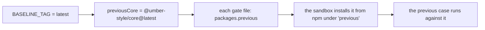

# baseline.ts

## What it does

Names the published release that the benchmark gate compares the build of this checkout with, and gives
the install spec of the core at that release. `BASELINE_TAG` is `'latest'`; `previousCore` is
`@umber-style/core@latest`.

## Why it exists

Every gate file in `bench/gate/` has to say which release is `previous`. Keeping the tag in one line
means a release changes one place. The gate files (`class-hit`, `class-merge`, `class-miss-large`,
`class-miss-small`, `extract-page`, `theme-class`, `theme-tokens`) import `previousCore` and pass it as
`packages: { previous: previousCore }`.

## The logic

The constant is read when a gate file is loaded. The sandbox installs the package named by the spec
before the cases run, and the `previous` case of each file loads it.

## What it guarantees

- One value decides the baseline of every gate file.
- It holds no logic and touches nothing at load time.

## Decisions

- The tag is `latest`, the stable release on npm (the comment records that 0.1.0 was the first). Why a
  dist-tag and not a fixed version is not recorded in the code.

## Limits

- Only the core has an install spec here, because the gate files measure the core alone.
