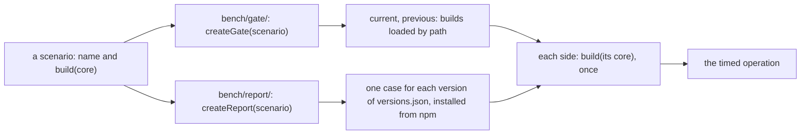

# scenarios.ts

## What it does

Holds the seven scenarios of the gate, each written once over the API of the core: `classMissSmall`,
`classMissLarge`, `classHit`, `classMerge`, `themeTokens`, `themeClass` and `extractPage`. Each is a
`Scenario` (`support.ts`): the label of its config, and a `build(core)` that makes a cache, an engine and
inputs from one build of the core and returns the timed operation. The comment above each says what one
operation is and which local file measures the same work.

## Why it exists

The same scenarios run in two places: the gate files of this folder (this tree's build against the build
of the last release) and the report files of `bench/report/` (versions installed from npm, after a
release). Written once, the two cannot drift apart, and a scenario added here is one line in each folder.

## The logic

Inside each `build`:

- The miss scenarios walk a pool of inputs and make a fresh cache each time the pool comes round
  (`createCycle`), or every 500 operations, so every operation misses and the fresh cache is a very small
  part of the figure.
- The hit and merge scenarios make their classes once, then time the call that finds them again.
- `themeClass` walks 100 large themes that differ in one value, with a fresh engine for each pass.
- `extractPage` builds the classes of ten pages once, and times the extraction of one page.

## What it guarantees

- Every scenario uses only the API that every release of the core since 0.1.0 has (`createCache`,
  `createMemorySheet`, `createEngine`, `createTokens`, `themeClass`, `markUsed`, `extractPageStyles`), so
  that it runs on the previous build and on the published versions alike.
- The inputs come from `bench/src/` and are the same on every run.

## Decisions

- The scenarios were moved here, unchanged, from the gate files, when the report after a release needed
  the same ones.

## Limits

- A scenario that needs an API a release does not have would fail on that release's side; nothing checks
  this before a run.
