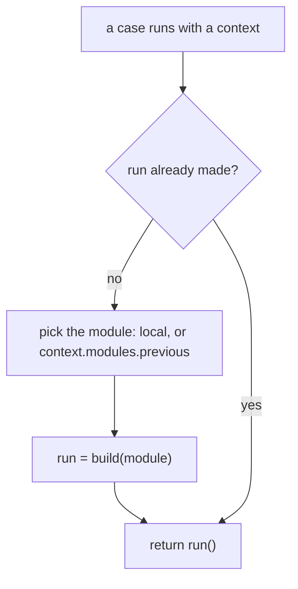

# support.ts

## What it does

`createSides(local, build)` returns the two cases of a gate scenario, `local` and `previous`. Each case
builds its own operation the first time it runs, from its own module: the local build for `local`, and
the module that soroush-bench installed under `previous` for the other.

## Why it exists

The gate compares the same operation on two builds of the core. If both sides shared a cache, a theme or
an input object, one would warm what the other measures. Building lazily and per side keeps the state
apart, and the operation is made once, so the timed call is only the operation. All the gate files
(`class-hit`, `class-merge`, `class-miss-large`, `class-miss-small`, `extract-page`, `theme-class`,
`theme-tokens`) use it.

## The logic

Each side has its own `run` variable inside its closure. `build` is where a gate file makes its cache,
its inputs and any warm-up, and returns the function that is timed.

## What it guarantees

- `build` runs at most once for each side, on the first call of that side.
- The two sides never share a `run`, so they never share what `build` created.
- It returns exactly the keys `local` and `previous`; the `baseline-case: previous` input of the CI
  step in `.github/workflows/ci.yml` relies on that name.

## Decisions

- `local` is passed in at creation and `previous` is read from the context at run time, because only the
  sandbox knows the installed module. The generic `M` types `build` by the local module and treats the
  previous one as the same shape, with a cast.

## Limits

- The cast of `context.modules.previous` to `M` is not checked: a baseline with a different API fails
  when the case runs, not when it is built.
