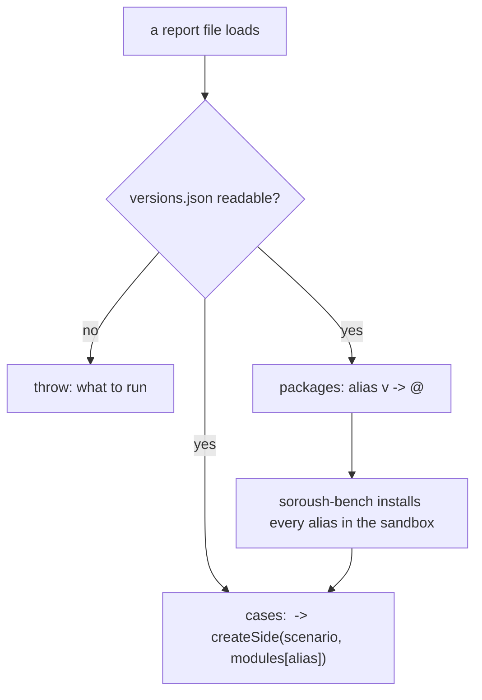

# support.ts

## What it does

`createReport(scenario)` makes the config of a report file: one case for each version listed in
`versions.json` (next to this file), named by the version, with `packages` that tell soroush-bench to
install each version from npm under its alias (`toAlias`: `v` and the version). Each case is a
`createSide` of `../gate/support.ts` whose module is the one soroush-bench installed under that alias.

## Why it exists

After a release, the report compares the version just published with earlier ones, every side installed
from npm the same way (the gate, which runs on a pull request, compares builds instead). The versions are
known only when the release is made, and nothing outside a bench file reaches the sandbox, so
`scripts/bench-report.mjs plan` writes them into `versions.json` (ignored by git) and the report files
read it when they load, run by `soroush-tech/bench-action`.

## The logic

## What it guarantees

- Every case is installed and loaded the same way, by npm alias, so no version has a loader of its own.
- Each version builds its own cache and inputs (`createSide`).
- The case key is the version as written, which the job gives the action as its `baseline-case` (the
  `baseline-case` output of `scripts/bench-report.mjs plan`).

## Decisions

- **The versions in a file and not in the bench file**: they change with each release, and the sandbox
  gives a bench file no environment variable.

## Limits

- A version whose API lacks what a scenario uses fails in its case; the scenarios use only what every
  release has (`../gate/scenarios.md`).
