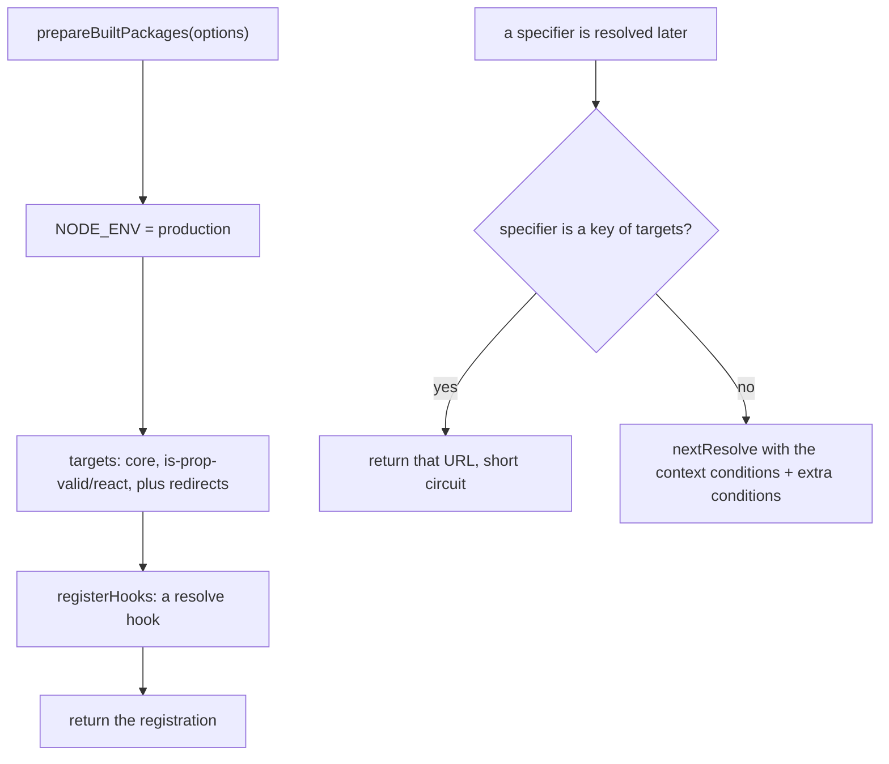

# built.ts

## What it does

`prepareBuiltPackages(options)` makes the modules loaded after it behave as a built app: it sets
`NODE_ENV` to `production`, redirects `@umber-style/core` and `@umber-style/is-prop-valid/react` to the
CommonJS builds in `dist` of this checkout, applies any extra redirects, and adds extra export
conditions to every other resolution. It returns the registration, whose `deregister()` ends it.

## Why it exists

soroush-bench runs a benchmark file with tsx in a sandbox where nothing sets an environment variable or
an export condition, and where the workspace links of the core and the prop filter point at TypeScript
source (their `exports` name `dist` only in `publishConfig`). A binding benchmark must measure the built
code, so it calls this function first and loads React, Vue and the built binding afterwards. The
fixtures and benchmark files of `react`, `react-native`, `vue` and `css` call it, and so does
`bench/src/built.test.ts`.

## The logic

The check uses `Object.hasOwn`, so a specifier such as `toString` is not a hit. A redirect with the same
key as a built-in target replaces it (the spread comes last).

## The data

- `redirects`: bare specifier -> file URL, for a platform module that needs a stand-in.
- `conditions`: strings such as `react-server`, appended to the conditions of every other resolution.

## What it guarantees

- Only modules resolved after the call are affected; a hook registered earlier runs after this one.
- Without options, no condition is added.
- It does not touch a browser global, and the hook is removed by `deregister()`.
- `NODE_ENV` stays `production` after `deregister()`: only the hook is removed (the test restores the
  variable itself).

## Decisions

- Resolution hooks (`registerHooks` of `node:module`) are used, since nothing outside the file can set
  the environment inside the sandbox.
- It points at the `.cjs` builds. The reason is not recorded in the code beyond the comment that files
  load their packages after the call, with `createRequire`.

## Limits

- Only the core and the React prop filter are redirected by default; a file that needs another workspace
  package built passes it in `redirects`.
