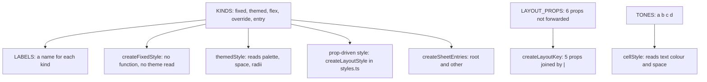

# components.ts

## What it does

Holds what the binding benchmark files share about the components they render: the five kinds of the
48-element cases and their labels, the six layout props that a component keeps to itself, the key of a
combination of props, the four tones of a cell, and the style builders of the web components.

## Why it exists

The React, Vue and React Native benchmarks must render the same trees to be comparable, but each makes
its components with its own `styled`. This file holds the part that does not depend on the binding, so
each fixture only wires it to its `styled`. It is used by the fixtures and benchmark files of `react`,
`vue`, `react-native` and `css`.

## The logic

There is no control flow: the file is constants and small builders. `createLayoutKey` joins `gap`,
`direction`, `align`, `justify` and `wrap` and leaves out `padding`, which `createCombinations` derives
from `gap`, so the 48 keys are still distinct.

## The data

- `Kind`: `'fixed' | 'themed' | 'flex' | 'override' | 'entry'`; `Tone`: `'a' | 'b' | 'c' | 'd'`.
- `createSheetEntries()` returns `{ root: { margin: 4, outline: '1px solid blue' }, other: { margin: 8 } }`;
  `root` has the declarations of the `override` kind.

## What it guarantees

- `createFixedStyle` and `createSheetEntries` return a new object on each call, so no case mutates
  another's input.
- The style functions are typed on `SmallTheme` and read only theme tokens.
- No top-level browser access.

## Decisions

- The kinds and labels are data, so the case names are the same for every binding.
- The layout props are a set: they only drive the style, and the layout component does not forward them
  to its element.

## Limits

- The style builders are for the web components (React and Vue); React Native makes its own.
