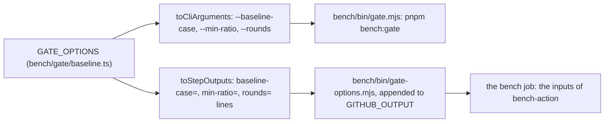

# gateOptions.ts

## What it does

Gives how the benchmark gate judges a run (`GateOptions`: the baseline case, the minimum ratio, the
rounds) in the two forms its readers need: `toCliArguments` makes the options of the soroush-bench CLI
(`--baseline-case previous --min-ratio 80 --rounds 5`), and `toStepOutputs` the lines `name=value` that a
step of a workflow appends to `$GITHUB_OUTPUT`, named as the inputs of `soroush-tech/bench-action`.

## Why it exists

The gate runs in two places: the `bench` job of `.github/workflows/ci.yml`, through the action, and
`pnpm bench:gate` on a machine (`bench/bin/gate.mjs`), through the CLI. Each wrote the three values of its
own, so they could drift. The values are now one constant, `GATE_OPTIONS` of `bench/gate/baseline.ts`, and
the forms are made here, where the bench package's tests hold them at 100% coverage; the scripts import
them (Node runs the TypeScript file by stripping its types).

## The logic

## What it guarantees

- Both forms carry the same three values, written as numbers are written by `String`.
- The names of the outputs are those of the inputs of the action, so the job passes each as it is.

## Limits

- What the job does with the outputs is checked by actionlint and by a run of CI, not by these tests.
