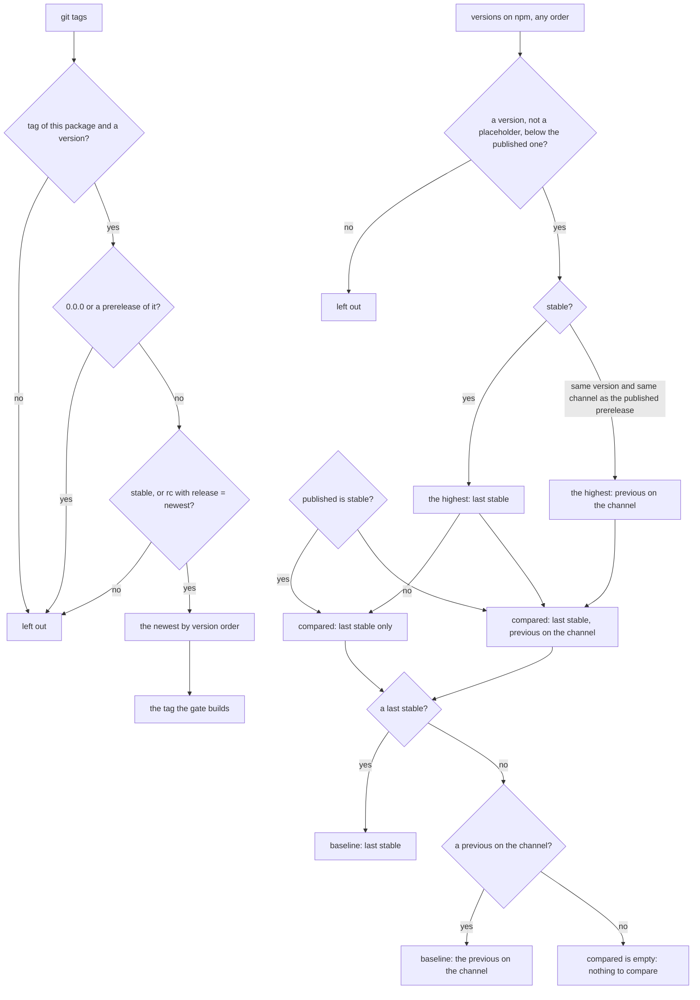

# releases.ts

## What it does

Decides which released versions a benchmark compares. `parseVersion` splits a version into its numbers
and prerelease identifiers, `compareVersions` orders two versions as semantic versioning does, and
`isPlaceholder` tells `0.0.0` and its prereleases apart. On top of them:

- `pickBaselineTag(tags, name, release)` picks, out of the git tags of the repository, the tag of the
  release the benchmark gate builds as its `previous` side: the last stable tag of the package, or with
  `release: 'newest'` the newest tag, stable or release candidate.
- `planReport(available, published)` picks, out of the versions the npm registry lists for a package, the
  versions the report after a release compares with the version just published, and the one its ratios
  are against.

## Why it exists

The two scripts that read git and the registry (`bench/bin/previous.mjs` for the gate,
`scripts/bench-report.mjs` for the report) are hard to test: they need the network, git and `gh`. The
rules they follow are pure functions of lists of strings, so they live here, where the bench package's
tests hold them at 100% coverage, and the scripts import them (Node runs the TypeScript file by stripping
its types). It is in `bench/src/` and not in `scripts/` because `scripts/` has no test runner.

## The data

- A tag is `<package name>@<version>`, as `cd-packages.yml` creates one for each rc and stable release.
  Alphas have no tag.
- A version is `major.minor.patch` with an optional prerelease (`-alpha.4`, `-rc.0`). Build metadata
  (`+...`) is not read: the registry and the tags never carry it.
- A report plan is the published version, the versions it is compared with (oldest first, each with
  its role: `last stable`, or `previous <channel>` such as `previous rc`), and the baseline: the version
  every ratio of the report is against.

## The logic

## What it guarantees

- A placeholder is never compared.
- A prerelease is compared only with a prerelease of its own channel and version (an rc with an rc, an
  alpha with an alpha), and a stable release only with the last stable.
- The order of the registry's list does not matter: every choice is by version order, not by position.
- Only versions below the published one are compared with it, so a report made later for an older
  release (as the examples of `docs/benchmarks.md` are) sees what was there at the time, by version order.
- `compared` is empty exactly when there is no baseline.

## Decisions

- **Which release the gate builds** is not decided here: `pickBaselineTag` takes it as an argument, and
  the one constant that says it is `BASELINE_RELEASE` in `bench/gate/baseline.ts`.
- **The owner's table of comparisons**: an rc with the previous rc of the same version and the last
  stable; an alpha with the previous alpha of the same version and the last stable; the first prerelease
  of its channel for a version with the last stable only; a stable release with the previous stable only.
  "Previous" is the highest that exists below the published one, so a number that was never published is
  passed over.
- **A package with no stable yet** is compared with the previous release of the channel, which is then
  the baseline, because there is no stable to be against.

## Limits

- The version order is semantic versioning's; a registry or a tag that writes versions another way
  (`v1.0.0`) is left out, not read.
- "Older" is by version order, not by the time of publishing: a patch of an old line published after a
  newer version is still compared with the stable just below it.
