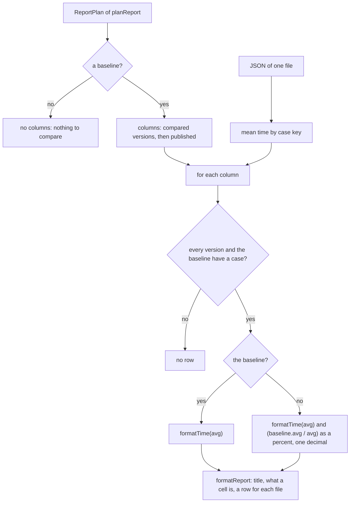

# reportTable.ts

## What it does

Lays out the table of the benchmark report after a release from what soroush-bench writes with
`--json-file`. `createColumns(plan)` turns a `ReportPlan` of `planReport` into the columns of the table
(the versions compared, oldest first, then the published one, and the baseline), `createReportRow(json,
columns)` makes the row of one report file, `formatTime(ns)` writes a time as the tool's own table does,
and `formatReport(spec, columns, rows, rounds)` writes the markdown of one package's report.

## Why it exists

`scripts/bench-report.mjs` needs Docker, the network and `gh`, so it has no test. What it does with the
numbers that come back is a pure function of them, so it lives here, where the bench package's tests hold
it at 100% coverage, next to `releases.ts`; the script imports it (Node runs the TypeScript file by
stripping its types). Before soroush-bench 2.3.0 the script read the tool's printed table and the lines
its gate printed for a target no case could reach; the JSON makes both unnecessary.

## The data

- The JSON of one file: `{ name, cases: [{ label, key, avg, p75, alloc }] }`, `avg` in nanoseconds (with
  `--rounds`, the median of the rounds), one case for each version, keyed by the version.
- The columns: `{ baseline, versions: [{ version, role }] }`, the role `last stable`, `previous <channel>`
  or `published`.
- A row: the name of the file's config, then one cell for each column: the mean time, and for every
  version but the baseline the speed against it in brackets (`2.22 us (91.4%)`).

## The logic

## What it guarantees

- A time is written as soroush-bench's markdown table writes it (two decimals in `ms` or `us`, whole
  `ns`), with `us` in place of the micro sign, so that the table stays ASCII.
- The ratio is the one the gate of soroush-bench checks, `baseline.avg / case.avg` in percent, with the
  one decimal its gate prints: above 100% is faster than the baseline.
- A file whose JSON lacks a version has no row; the script then says so.

## Decisions

- **The ratio is worked out here, not read as the tool's `ratioPct`.** The tool writes `ratioPct` only
  with `--baseline-case`, which it accepts only together with `--min-ratio`, a positive number: reading it
  would mean running a gate again, with a target chosen so that nothing fails. Dividing the two means of
  the JSON is the same formula, needs no gate, and lets the script read the tool's exit code as whether the
  file ran.
- **The layout of the table is the one the report always had**: one row for each scenario, one column for
  each version.
- **Not the bench action.** `soroush-tech/bench-action` 1.2.0 refuses a `min-ratio` that is not above 0
  (`main` of its `src/index.ts`), so it cannot run these files as a report that never fails; the script
  keeps running the CLI.

## Limits

- It trusts the JSON: a case whose key is no version of the columns is ignored, not reported.
