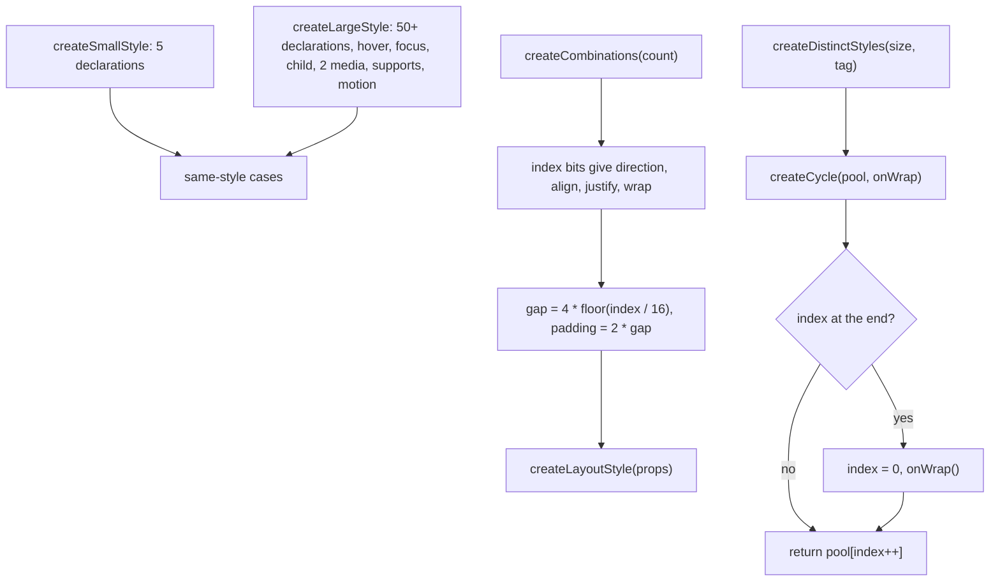

# styles.ts

## What it does

Builds the style inputs of the benchmarks: a small style object, a large one that nests, the layout
component's style and its fixed part, a list of distinct prop combinations, a pool of distinct small
styles, and `createCycle`, which walks a pool and calls a function each time it wraps.

## Why it exists

A benchmark is only comparable when every run measures the same input. These builders return plain
data, the same on every call, so the core, css and binding benchmarks and the gate files measure the
same styles. The cache benchmarks also need a style the cache has not seen (`createDistinctStyles` with
`createCycle`). It is imported by `bench/gate/*.bench.ts`, `bench/src/components.ts` (the types) and the
benchmarks of `core`, `css` and the bindings.

## The logic

## The data

- `LayoutProps`: `gap`, `direction`, `align`, `justify`, `wrap`, `padding`.
- `createCombinations(48)` uses the gaps 0, 4 and 8, each for 16 combinations of the four two-way props.
- A distinct style: `{ color: 'red', padding: index + 1, margin, '&:hover': { opacity } }`. With a `tag`
  the margin is `` `${index}px ${tag}` ``, so two pools with different tags do not collide.

## What it guarantees

- The same arguments give equal values, in the same order.
- `createCycle` calls `onWrap` only when it comes back to the first item, not on the first pass, so a
  case can make a fresh cache once for each pass over the pool.

## Decisions

- Combinations are counted in binary, so no random value and no seed is needed.
- `onWrap` exists so that the cache is made once for each pass and not once for each operation.

## Limits

- `createDistinctStyles` differs in `padding`, so its styles are distinct for any pool size; the opacity
  repeats every 10.
- An empty pool makes `createCycle` call `onWrap` and return `undefined` on every call.
