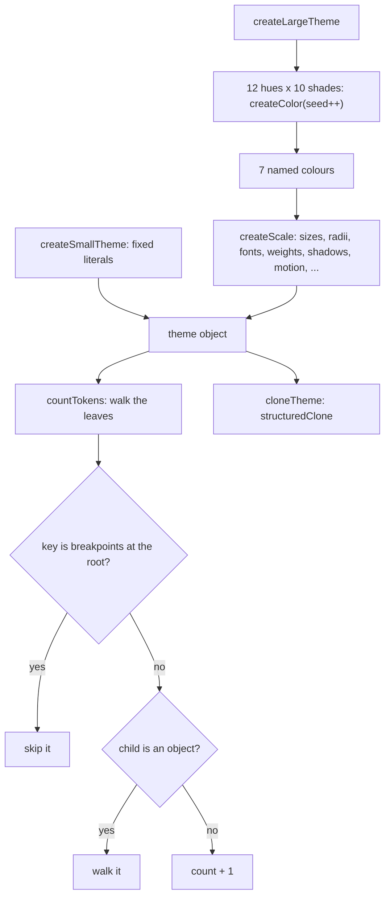

# themes.ts

## What it does

Builds the two themes of the benchmarks, a small one (20 tokens) and a large one (281 tokens),
as plain data. `countTokens` counts the leaves of a theme and `cloneTheme` returns a copy that is a
different object with the same values.

## Why it exists

Token benchmarks must measure the same input on every run, at two sizes. The clone gives a theme the
engine has not seen, so a case that must miss the theme caches can do it. The gate files `theme-class`
and `theme-tokens`, and the benchmarks of `core` and the bindings, use it.

## The logic

## The data

- `SmallTheme`: `palette` (6 colours), `space`, `radii`, `fontSizes`, `typography` and `breakpoints`
  (`['40em', '64em']`).
- `LargeTheme`: palette, space, sizes, radii, fontSizes, fontWeights, lineHeights, letterSpacings,
  typography, shadows, zIndices, borderWidths, durations, easings, opacities and five breakpoints.
- `createColor(index)`: `(index * 2654435761) % 0x1000000` as a six-digit hex; the same index gives the
  same colour. These hex values are benchmark data, not engine values.

## What it guarantees

- Every call builds an equal theme; no random value is used.
- `countTokens` does not count the root `breakpoints`, which are real values and not tokens.
- `cloneTheme` returns a different object that is deeply equal.

## Decisions

- Scales are generated by `createScale(prefix, count, make)` and named `<prefix><index>`.

## Limits

- The counts in the comments (20 and 281) are the ones `themes.test.ts` asserts: a change to a scale
  changes the test and the comments together.
- `countTokens` counts the elements of an array as leaves, as it does for `space`.
