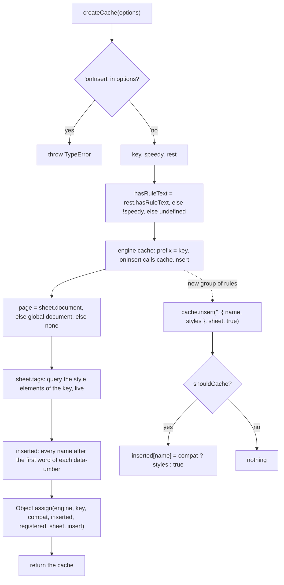

# index.ts

## What it does

`createCache({ key, ...options })` makes the engine's cache (`createCache` of `@umber-style/core`) with `key`
as its prefix, and adds the members that server-rendering set-ups read: `key`, `compat`, `inserted`,
`registered` (also readable by class name), `sheet` (the style elements of the key) and `insert`. It
re-exports the types `SerializedRule`, `UmberCache` and `UmberSheet` of the core.

## Why it exists

A server-rendering set-up reads a cache by a fixed set of members and keeps the ids it has already
written in `inserted`. The core's cache does not have those members and knows no document. This package
is the thin layer that gives them, so the engine stays framework-free. `@umber-style/css` takes such a
cache as an instance's cache (`SharedCache`), and `@umber-style/server/create-instance` reads it. The
fixture app of `fixtures/next-app` and the tests of `server` use it.

## The logic

`onInsert` of the engine fires for each new group of rules, so replacing `cache.insert` lets code see each
rule once. `registered` is a proxy over the engine's map: a string key that is in the map answers `true`
(so `cache.registered[className]` is truthy), and any other property is read from the map, with functions
bound to it, so `get`, `has` and `size` still work.

## The data

- `UmberCacheOptions`: the options of the engine's cache without `prefix` and `onInsert`, plus `key` and
  an optional `speedy`.
- `inserted`: `Record<string, string | true>`: name -> `true`, or the CSS text of the rule when `compat`
  is set (the test "records the CSS text of each rule when compat is set").
- The seed: a style element carries `data-umber="<key> <name> <name>..."`; the first word is the key and
  is dropped, the rest become `inserted` entries.

## What it guarantees

- The returned object is the engine's own cache object, so everything the engine does still works.
- `onInsert` is the cache's own: passing it throws a `TypeError` (the check is for plain JavaScript; the
  type already forbids it).
- `hasRuleText` wins over `speedy`; `speedy: true` means `hasRuleText: false`.
- `nonce` is an option of the engine's cache, passed on as it is: the cache's own style element carries
  it, `cache.nonce` holds it, and `@umber-style/server` writes it into its tags. A server that makes a cache
  for each request gives each its request's nonce.
- No browser global is read at module top level: `document` is read inside the call, guarded by
  `typeof document`. Without a document `sheet.tags` is `[]`.
- Two caches with different keys keep their rules apart (test "keeps the rules of two caches apart").

## Decisions

- `speedy` is kept for compatibility with what apps pass from the library they move from; the code names
  no such library.
- `key` replaces `prefix` as the name of the option.
- The sheet's `tags` is a getter, so it lists the elements at the time it is read, not at creation.
- `compat` starts `false`; a set-up can set it to `true` to have `inserted` hold CSS text.

## Limits

- It reads names from `data-umber` only at creation: elements that arrive later are not read into
  `inserted`.
- `sheet` has only `tags`; it cannot write or remove rules (the engine's own sheet does that).
