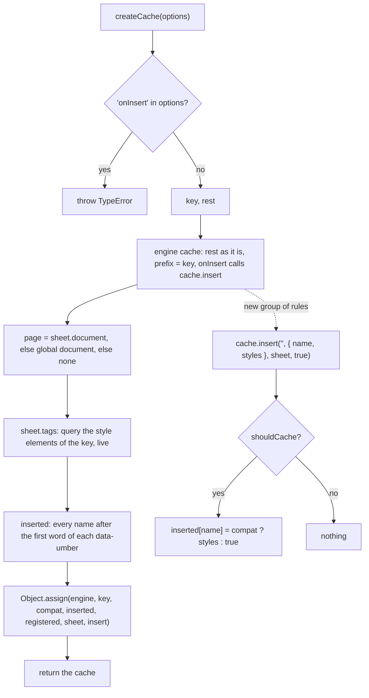

# index.ts

## What it does

`createCache({ key, ...options })` makes the engine's cache (`createCache` of `@umber-style/core`) with `key`
as its prefix, and adds the members that server-rendering set-ups read: `key`, `compat`, `inserted`,
`registered` (also readable by class name), `sheet` (the style elements of the key) and `insert`. It
re-exports the types `SerializedRule`, `UmberCache` and `UmberSheet` of the core. `createCache` is the
default export of `@umber-style/cache` and a named one.

## Why it exists

A server-rendering set-up reads a cache by a fixed set of members and keeps the ids it has already
written in `inserted`. The core's cache does not have those members and knows no document. This package
is the thin layer that gives them, so the engine stays framework-free. `@umber-style/css` takes such a
cache as an instance's cache (`SharedCache`), and `@umber-style/server/create-instance` reads it. The
fixture app of `fixtures/next-app` and the tests of `server` use it.

## The logic

`onInsert` of the engine fires for each new group of rules, so replacing `cache.insert` lets code see each
rule once. `registered` is a proxy over the engine's map: a string key that is in the map answers `true`
(so `cache.registered[className]` is truthy), and any other property is read from the map, with functions
bound to it, so `get`, `has` and `size` still work.

## The data

- `UmberCacheOptions`: the options of the engine's cache without `prefix` and `onInsert`, plus `key`.
  `speedy` is one of them, an option of the core.
- `inserted`: `Record<string, string | true>`: name -> `true`, or the CSS text of the rule when `compat`
  is set (the test "records the CSS text of each rule when compat is set").
- The seed: a style element carries `data-umber="<key> <name> <name>..."`; the first word is the key and
  is dropped, the rest become `inserted` entries.

## What it guarantees

- The returned object is the engine's own cache object, so everything the engine does still works.
- `onInsert` is the cache's own: passing it throws a `TypeError` (the check is for plain JavaScript; the
  type already forbids it).
- `speedy` is passed on as it is, with the core's meaning (`true`: `insertRule`). An object with
  `hasRuleText`, the core's name for it before 0.3.0, reaches the core's `createCache` as `rest`, which
  warns about it once in development and does not read it.
- `nonce` is an option of the engine's cache, passed on as it is: the cache's own style element carries
  it, `cache.nonce` holds it, and `@umber-style/server` writes it into its tags. A server that makes a cache
  for each request gives each its request's nonce.
- No browser global is read at module top level: `document` is read inside the call, guarded by
  `typeof document`. Without a document `sheet.tags` is `[]`.
- Two caches with different keys keep their rules apart (test "keeps the rules of two caches apart").
- The named export `createCache` is the default export, with the same type (the test "is the named
  export too, with the same type").

## Decisions

- `speedy` is the name apps pass from the library they move from, and since 0.3.0 the core's own name, so
  this package has no option of its own for it and translates nothing; the code names no such library.
- `key` replaces `prefix` as the name of the option.
- The sheet's `tags` is a getter, so it lists the elements at the time it is read, not at creation. The
  cache's own element is made at its first rule (`createDomSheet` of the core), so a cache that has written
  nothing lists only the elements a server sent, and a cache that writes nothing never adds one.
- `compat` starts `false`; a set-up can set it to `true` to have `inserted` hold CSS text.
- The function is the default export and also a named one, the same function. A library that is an ES
  module package and ships a CommonJS build has its bundler compile `import createCache from '@umber-style/cache'` as Node's
  interop does, where the default is the whole `module.exports` (`{ __esModule: true, default, createCache }`),
  not the function, so it throws `is not a function`; `import { createCache } from '@umber-style/cache'` gets the function.
  The shape of the CommonJS file (`cjsDefault: false` in `tsdown.config.ts`) was left as it is: making the
  function `module.exports` would change what every existing `require` of the entry gets.
  `scripts/smoke-packed.mjs` runs that interop on the packed tarball.

## Limits

- It reads names from `data-umber` only at creation: elements that arrive later are not read into
  `inserted`.
- `sheet` has only `tags`; it cannot write or remove rules (the engine's own sheet does that).
