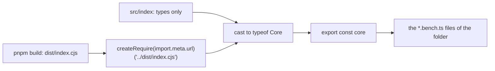

# core.ts

## What it does

Exports `core`: the module of the built core, `packages/core/dist/index.cjs`, loaded with `createRequire`
and typed as `typeof import('../src/index')`. The benchmark files of the core read every engine function
from it.

## Why it exists

A local benchmark measures the built `dist`, as an app loads it, not the source. Fifteen files of this
folder import it (the `classes-*`, `extraction`, `helpers-*`, `page-startup`, `pruning-*`, `sheets-*` and
`tokens-*` benchmark files), so the load and its type live once. The load is by path with
`createRequire`, as the gate files do, so no module resolution of the workspace is involved (the
workspace link of `@umber-style/core` points at TypeScript source; see `docs/benchmarks.md`). The type
comes from `src`, so that the type check passes on a tree that was never built.

## The logic

The load runs when the first benchmark file imports the module; a missing `dist` throws there.

## What it guarantees

- It loads built code, never the source, and it imports the source as a type only, so nothing of `src`
  runs.
- It touches no browser global.

## Limits

- It needs `pnpm build` first. `pnpm bench` builds before it runs; a direct run of one file does not.
- The type and the code can differ if `dist` is stale: nothing checks that they match.
- It does not call `prepareBuiltPackages`: it loads no React, Vue or other module that reads
  `NODE_ENV`, so nothing here sets it.
