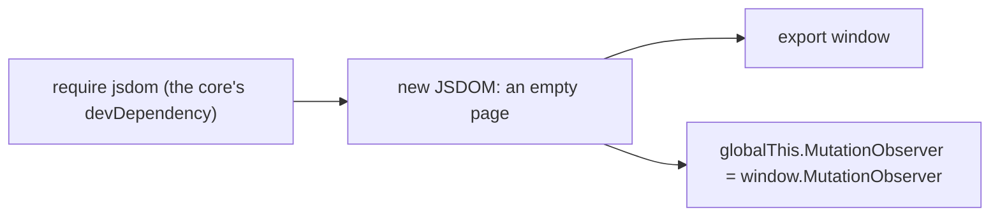

# dom.ts

## What it does

Makes one document of jsdom for the benchmark files of the core that need a DOM
(`page-startup.bench.ts`, `sheets-dom.bench.ts`), exports its `window`, and puts jsdom's
`MutationObserver` on `globalThis`.

## Why it exists

The soroush-bench sandbox runs Node, which has no DOM. Reading the style elements a page already has, and
writing rules into a style element, need one. The cache watches its page for style elements that arrive
later with the global `MutationObserver`, which Node does not have.

## The logic

## What it guarantees

- One window for the process. Its own document has style sheets; a document made with
  `window.document.implementation.createHTMLDocument` has none (jsdom gives a style sheet only to a
  document with a window).

## Decisions

- A file that makes many caches over a page replaces the observer with a stand-in of its own
  (`page-startup.bench.ts`): jsdom's observer keeps every cache it was given reachable after its page is
  gone, about 22 KB a cache in Node, and a file of five rounds ran out of the sandbox's 512 MB.

## Limits

- jsdom's DOM, its CSS parser and its style sheets are not a browser's: a figure made over them says what
  the engine's own code and jsdom cost, not what a page costs.
