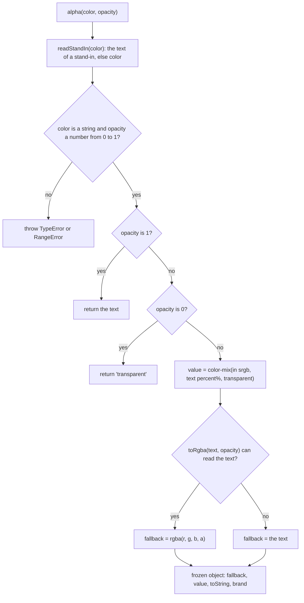

# alpha.ts

## What it does

`alpha(color, opacity)` returns a colour at an opacity. For an opacity between 0 and 1 it returns an
`AlphaColor`: a frozen object with a `fallback` (an `rgba()` string) and a `value` (a `color-mix()` string),
which prints as `value`. For 1 it returns the colour as given, for 0 the string `transparent`. The file also
reads colour literals (`toRgba`), validates the input (`assertAlphaInput`) and tells an `AlphaColor` from a
plain string (`isAlphaColor`).

## Why it exists

A token is a `var(--x)` reference, and a reference has no channels the engine can read, so a transparent
version of a theme colour has to be made by the browser: `color-mix(in srgb, <color> <n>%, transparent)`.
A browser without `color-mix()` drops the whole declaration, so a literal colour also gets an `rgba()`
declaration written before it. The result is an object, not a string, because the serializer needs both
texts and has to know when the pair is the whole value of a property.

It is its own file because several modules use it: `serialize.ts`, `calc.ts`, `findInvalidValues.ts`,
`globalStyles.ts`, `keyframes.ts`, `styleTypes.ts`, `templateStyle.ts`, `webStyle.ts`, `index.ts`, `internal.ts` and
`packages/react-native/src/index.ts`.

## The logic



The text of a `keyframes` stand-in is read first, so a stand-in is treated as the reference it stands for.
The percent is the opacity times 100, rounded to two decimals. `toRgba` tries the hex reader, then the two
`rgb()` patterns (comma syntax, and space syntax with `/` before the alpha). An alpha the colour already has
is multiplied by `opacity` and rounded to four decimals, so float noise (`0.1 * 3`) does not reach the CSS.
Channels of `rgb()` are rounded and clamped to 0 to 255; the alpha of a function is clamped to 0 to 1 and
may be a percent.

## The data

`AlphaColor` has `fallback`, `value` and `toString()`, defined with `Object.defineProperties`: `fallback`
and `value` are enumerable, `toString` and the brand are not. The brand is the key
`Symbol.for('umber-style.alpha-color')`.

```
alpha('var(--x)', 0.25) -> { fallback: 'var(--x)', value: 'color-mix(in srgb, var(--x) 25%, transparent)' }
```

## What it guarantees

- The result is frozen, and `String(result)` and a template literal give `value`, which stays valid CSS
  inside a longer value (`1px solid ${alpha(c, 0.5)}`).
- `isAlphaColor` is true only for what `alpha()` made: a plain `{ fallback, value }` object is not one.
- An opacity outside 0 to 1 (NaN and the infinities included) throws a `RangeError`; a colour that is not a
  string or an opacity that is not a number throws a `TypeError` (`alpha.test.ts`).
- It touches no browser global, so it is safe to load on the server.

## Decisions

- The result is a branded, frozen object instead of a string, so that the serializer can write the fallback
  only when the value is the whole value of a property (the doc comment of `AlphaColor`).
- The brand is a registered symbol (`Symbol.for`), not a private one; the reason is not recorded in the
  code.
- Only literals the engine can read get an `rgba()` fallback; any other colour is its own fallback.

## Limits

- `toRgba` reads hex and `rgb()`/`rgba()` with plain numbers only. Named colours, `hsl()`, `oklch()` and
  `var()` get no `rgba()` fallback: `alpha('var(--x)', 0.25).fallback` is `var(--x)` (`alpha.test.ts`).
- In a longer string the fallback is lost, by design.
