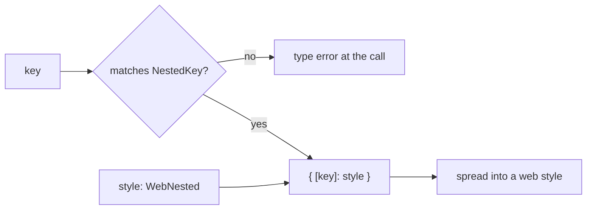

# at.ts

## What it does

`at(key, style)` returns `{ [key]: style }` with a type that lets it be spread into a web style. At run
time it only builds the one-key object. The file also exports `NestedKey`, the type of the keys that hold a
nested style.

## Why it exists

A computed key in an object literal has the type `string`, and the web style type rejects it because its
custom property signature takes no style. `at` keeps the literal type of the key
(`` `@media (width >= ${breakpoint})` ``) and checks `style` as a `WebNested`, so
`{ ...at('@media (width >= 600px)', { gap: 16 }) }` type checks without a cast at each breakpoint. Only
`index.ts` imports it, to export it.

## The logic

The decision is made by the type checker, not at run time. `NestedKey` is a union of three template
literals: a selector with `&`, a key that starts with `:`, and an at-rule that starts with `@`. The body is
one line and casts the result to `Record<K, WebNested>`.

## What it guarantees

- The returned object has one own key, the one given, and its value is the style as given, not a copy.
- It spreads into a style that the serializer compiles (`at.test.ts`).
- It never reads the style and never validates the key at run time.

## Decisions

- The cast in the body is the only unchecked part; the doc comment gives the reason for the function: a
  computed key widens to `string`.

## Limits

- A key that is not a `NestedKey` is rejected by the type checker only; a JavaScript caller gets no error.
