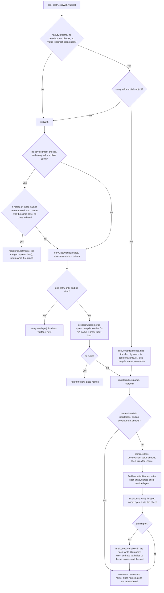
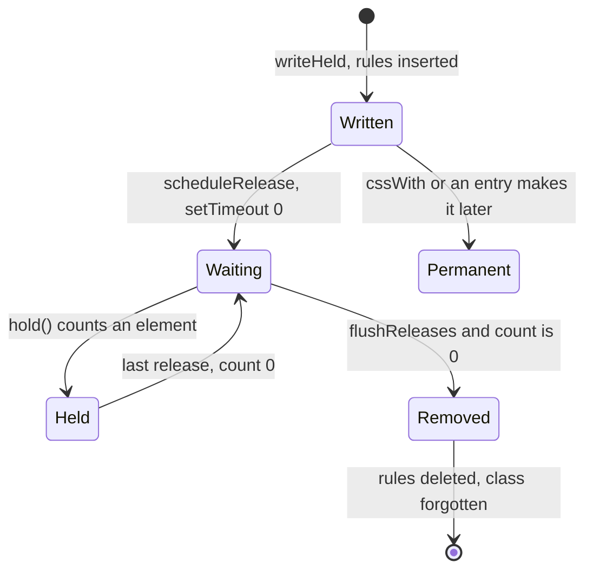
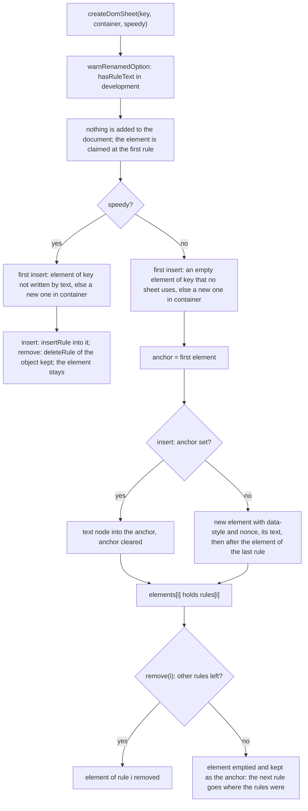

# cache.ts

## What it does

`createCache(options)` makes the cache of an engine: it turns styles into class names, writes the rules of
each class once into a sheet, declares theme variables, holds global rules and `@keyframes`/`@property`
rules, and gives back the CSS of the whole sheet or of one page. The file also has the sheets the cache
writes to (`createMemorySheet`, `createDomSheet`), the layer list (`RULE_LAYERS`), and the selector of
the style elements an engine owns (`createStyleSelector`). Every type of the cache API is declared here.

## Why it exists

A runtime engine has three jobs that depend on one another: a class name must come from the style alone
(so the same style gives the same class on the server and in the browser), a rule must be written once,
and the CSS of a page must be knowable. They share state (what is written, which variables are used, what
the page already holds), so they live in one closure. The engine (`createEngine.ts`) makes a cache and
builds themes, sheets and stylers on it; `css.ts`, `extractStyles.ts`, `sheetEntry.ts`, `theme.ts`,
`types.ts` and `umberCache.ts` import its types; `index.ts` exports it. Bindings and `@umber-style/cache`
and `@umber-style/server` build on its public members.

## The logic

`insertLayered` writes the layer order statement before the first rule, writes each rule to the sheet,
reports the group to `onInsert`, and asks the dev checker (`checkLater`) to look at the page later. A cache
whose sheet is a style element of its page joins the check of that page that every cache of its prefix
there shares (`joinPageCheck`, `cacheRegistry.ts`), so two caches of one prefix (the engine's own and an
app's `createCache({ key })`) tell each problem once; any other cache with a page (a sheet in memory)
has a check of its own (`createDevChecker`), as before.

Held classes (`cssHeld`) are for a plain style object a component is given from outside, so that a
changing value leaves no class behind:

A DOM sheet writes in one of two ways (`createDomSheet`). By `insertRule`, every rule goes into one
element. By text, every rule is the text of an element of its own, so that the document parses that rule
once and never the rules before it again (one element of N text nodes was parsed again for each node,
which grew with the square of N):

The rest of the closure, in the order of the file:

- Page reading. When a document exists, the cache scans the style elements of its prefix once, and any
  that arrive later (a `MutationObserver` on `head` and `body`), with `scanStyleText`. An element written
  by text (`elementModes`) is skipped at once: it holds a rule of a sheet of the engine, never one a server
  sent, and one arrives for every rule such a sheet writes. What it finds
  (classes, layer order, `@property` and `@keyframes` rules, theme classes with their variables, global
  rules, root rules) is marked as inserted, so nothing from a server render is written again. Root rules are the exception:
  they are not kept. Those found before the cache declares its root theme wait in `pageRoots`, which every
  declaration of another root theme empties, deleting them. Those of an element that arrives after the
  first declaration are deleted as it is scanned: they come later in the document than the rule of the
  cache, so they would win with the server's values. A theme switched while the page streams (a second
  declaration) would then be undone by a chunk that arrives after the switch, until the next declaration
  (`cache.root.test.ts`, `are removed on arrival after a switch of the theme`). Before it reads the page,
  `createCache` compares the options stamp of the server with its own and throws on a difference.
- Themes. `insertTheme` registers a theme class. With pruning a class declares only used variables, and
  `markUsed` adds more as rules refer to them, following values that refer to other variables. `insertRoot`
  declares one `:where(:root)` rule in the theme layer; another id replaces it.
- Global rules. `compileGlobal` gives `{ id, rules, animations }`; `insertGlobal` counts insertions per id,
  writes (or takes over from the page) once, and removes the rules when the last holder releases.
- Extraction. `extract` is the whole sheet. `extractPageParts` decides one page from its class names:
  layer order, `@property` rules, `@keyframes` rules, root and theme rules trimmed to the variables the page
  uses, global rules, then class rules; `extractPage` joins the two parts.
- `withStyleOptions` gives a view of the same cache that compiles with other declaration options.
- The document. `cache.document` is the document the cache serves (that of its sheet, else the global one,
  none on a server): what `declareLiveValue` of `liveValue.ts` writes the rule of a value into.
- The nonce. `CacheOptions.nonce` is held as `cache.nonce` (a view of `withStyleOptions` has it too) and
  given to the DOM sheet the cache makes for itself; `createDomSheet` sets it as the `nonce` attribute of
  every element it creates, before the element is in the document, in either way of writing (by text, the
  element of each rule). An element that the document had (a server's, or an empty one) is used as it is. The nonce is in no rule, class name or
  fingerprint: it is for the elements, and the tags of `extractStyles.ts`, `@umber-style/server` and the
  bindings read it from the cache.

## The data

- `merges` (one for each set of style options, on `WrittenAs`): the merges of class names alone (`css(a, b)`,
  `cx`), keyed by layer, label, `after` and the names joined; each entry holds the names, the style each had
  in `registered` then, the merged style, the class and what `cssWith` returned. It is checked by identity:
  a name whose style was set again (a hit, a held class written again) or removed makes the entry stale, and
  it is made again. At most `MERGE_LIMIT` (1000) entries; the oldest leaves first. Measured: about 450 KB for
  1000 entries, the same after 10,000 distinct merges of 10,000 classes (measured with `--expose-gc` on
  the build, for issue 10).
- `contents` (one for each set of style options, on `WrittenAs`, only with `hasStyleMemo` and without the
  development checks and value repair): the class of each merged style made of style objects alone, by
  its layer, `after` and contents (`contentMemo.md`). At most `CONTENT_STEP_LIMIT` (10,000) steps, then
  emptied.
- `registered`: class name -> merged `StyleObject`. `insertedIds`: what is written or found on the page.
  `insertedRules`: id -> the rules written for it. `animations`: class -> names it uses. `afters`: props
  class -> its base class.
- Class name: `[prefix, label, hash].join('-') + suffix`; the hash is of the rules, plus the layer when it
  is `overrides` and layers are on, plus `after`. Example from `cache.test.ts`: a name with prefix, label,
  hash and suffix. The label there is `toLabelPart(readLabel(merged))` (`cssName.ts`): `a-z`, `A-Z`, `0-9`,
  `_` and `-` are kept, white space at its ends is trimmed and every other code point becomes `-`, so a class
  name never needs an escape (a space would split the class attribute, a `.` or `:` would change the
  selector). `nameClass` is the one place every class name passes; with the development checks a label that
  is written differently is warned about once, with the label as the user wrote it (`readLabel` and the
  messages keep that).
- `ThemeEntry`, `RootEntry`, `GlobalEntry`, `HeldEntry` keep, for each, the variables written, where the rule
  sits in the sheet (so a rule can be replaced or removed), and counts.
- Layers: `theme`, `global`, `components`, `overrides`, from lowest to highest, named `<prefix>-<layer>`.
- `getFullRules(id)`: for a class, the list of `insertedRules` itself (the rules it was written with),
  the same list while the cache holds the class and a new one when a held class let go is written again;
  for a theme class or a root theme (an id of `themeNames`), the list made the first time it is asked for
  and kept in `fullThemeRules` until `registerProperties` changes the `@property` rules, which empties it.
  A theme class and a root theme are named by the hash of what they declare, so their rules change with
  nothing else. A server render asks for the full rules of every class of every element in each render
  (the style elements, `styleElements.ts` of the React binding), and of the root theme with every variable
  of the theme (159 on a design system's page): they were made again each time. `fullThemeRules` holds one
  list for each theme class and root theme asked for, which the cache already keeps for good.

## What it guarantees

- A class's rules are written once; the same style gives the same class; a class made in two layers or
  after two classes is two classes.
- Rules with the same text are never written twice (`@property` rules are keyed by name and text hash).
- The layer order statement is the first rule written, once.
- A remembered merge gives what merging again would give: the same names, each with the same style object,
  merge to the same class, and nothing is remembered with the development checks on.
- `extractPage` reads the cache and changes nothing, so pages rendered in any order get the same CSS, apart
  from the root theme, which is the one inserted last.
- Without a document nothing browser-specific runs: the sheet is in memory and nothing is watched. Nothing
  touches a browser global at module top level (`document` appears only as a default read when called).
- A cache over a sheet in a style element is recorded in `cacheRegistry` for its prefix.
- A prefix that does not match `^[a-z][a-z0-9-]*$` throws.

## Decisions

- A class that is written already is not compiled for its selector again: those rules are made only to be
  written, and `insertClass` writes nothing for a written class. With the development checks they still
  are, because `compileClass` checks the values first (a class a server sent is checked there too). This
  took a hit of a small style from 1.64 to 1.30 us and of the large one from 21.4 to 13.5 us (host, one
  process; with the serializer's changes 0.93 and 7.7 us).
- The merges of class names alone are remembered (`merges`), because a merge redid the merge, both compiles
  and the hash on every call: two classes went from 3.5 to 0.4 us, five from 6.8 to 0.6 us. Only class
  strings are remembered, never a style object, which code may change between two calls; and an entry is
  trusted only while each name still has the very style object it had, so a name made again, removed or
  registered for the first time makes the merge again. The class's `registered` style is then the merged
  style of the remembered call, equal to what merging again gives. Rejected: a memo by the identity of a
  style object (a hit in 0.03 us instead of 0.9): it would keep the class of an object that was changed
  after its first use, which today gives a new class; that is a change of behaviour, not made.
- With `hasStyleMemo` (off by default) a call of style objects alone finds its class by the contents of
  the merged style and is not compiled or hashed; it is merged and registered as every call is, so the
  class, the rules, `registered` and the sheet are what the full path leaves (`contentMemo.md`, with the
  cases it guards against). The compilers choose `cssWithMemo` or `cssWith` once, when they are made, so
  without the option the path is the one before it, with no check added.
- `registered` is set again on every call, also on a hit: two styles with the same rules can differ in
  what writes no rule (an empty nested object, a function value), and a later merge of the class name reads
  the style of the last call. Keeping the first one would be faster and is not done.
- The classes of a page are sorted by keys made once for each class, not in each comparison (the keys are
  distinct, so the order is the same).
- Pruning is the default: a theme class holds only variables a rule uses, so a page does not carry tokens it
  never reads. Without pruning every variable is declared.
- The class name is made from rules compiled without vendor prefixes (`naming`), so the name is the same
  with or without them.
- Two ways of writing to the DOM, text and `insertRule`, never share one element: changing the text of
  an element parses it again and drops inserted rules (the comment at `elementModes`). Text is the default
  outside production because it keeps `textContent` readable.
- Written by text, one element for each rule, not one text node for each rule of one element: a change of
  the text of an element parses all of it again. A later element is put right after the element of the
  sheet's last rule, so the rules of a sheet stay together and in the order of `rules`. Two sheets of one
  key never share an element (each element holds one rule of one sheet): a text sheet takes only an empty
  element that no sheet marked, and a second sheet of the key starts in the container.
- A DOM sheet finds or makes its element when its first rule is written, not when it is made, in both
  ways of writing: a cache or a sheet that writes nothing adds nothing to the document. Before, a style
  made at the top of a module with no nonce put an empty element with no nonce in the page at once, and a
  cache of the same key that had the nonce (a registry's, under a `CacheProvider`) found it and wrote into
  it, under a strict policy into an element the browser had refused. The element goes where it went (the
  end of `container`, at the time of the first rule now, so after what came into the container since the
  sheet was made). An empty element of the key that the page placed is still used and still not made by
  the engine; it goes to the first sheet of the key that writes, which may be one made after another
  sheet of the key. What reads the document needs no element of the sheet: `sheet.document` is the
  document of the container, the page is read and watched as before (the element, when it comes, is one
  the watch skips or finds empty), and `findCache` reads the cache by its document. Written with
  `insertRule`, the element stays when the last rule is removed, as the anchor of a text sheet does, so
  that a sheet is in one element for its whole life.
- When the last rule of a text sheet is removed, its element stays, empty, as the anchor of the next rule,
  rather than a reference to its neighbours, which other code may move or remove. The anchor is marked
  `text`, so no other sheet takes it.
- `speedy` (true: `insertRule`) is the name of the option, the one boolean without `is` or `has`, because
  it is what apps already pass. It is not in the fingerprint: the two ways of writing give the same rules,
  so a server and a browser of different modes hydrate as before. `createCache` and `createDomSheet` call
  `warnRenamedOption` for `hasRuleText`, its name before 0.3.0, which is not read.
- `elementModes` and `writtenText` keep their shared keys (`@1`): a copy of the core of an earlier release
  reads them, and skips the text nodes of `writtenText` when it scans an element written by text. This
  copy never scans such an element, so it only adds to `writtenText`.
- A held class is removed after one macrotask, so a class let go and held again in the same task stays.
- The sheet decides removal: without `remove` every class is permanent and global rules stay.
- Keyframes live outside every layer (an at-rule that is not a layer's to hold).

## Limits

- A sheet without `remove` cannot release held classes or global rules; they stay and count as written.
- A nonce is set only on a style element the sheet creates. Written with `insertRule`, the sheet uses the
  element of a server when there is one, which carries the server's nonce or none; the cache does not check.
  `options.nonce` is not read when a `sheet` is given.
- A text sheet puts a new element after the element of its last rule. If other code removed that element
  from the document, the new one is not put in the document, and its rule is not on the page.
- A copy of the core of an earlier release that writes by text takes any element marked `text`, so it can
  put its rules into an element of a sheet of this copy, which removes them with its own rule.
- Page global rules whose rule objects cannot all be matched to the page are left in place when released
  (`removeGlobal`, `removeHeld` return without deleting).
- The root theme of a page is the one in the sheet; one cache that renders pages with different root
  themes must render and extract one page before the next (doc comment of `extractPage`).
