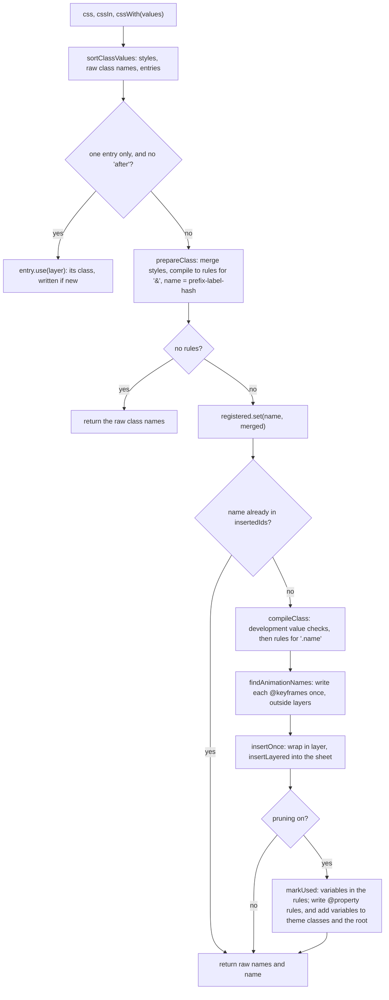
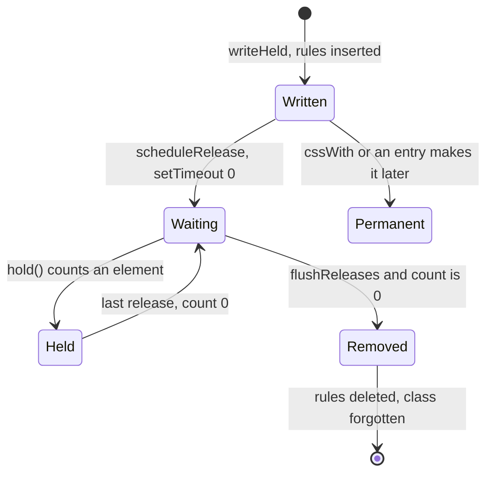

# cache.ts

## What it does

`createCache(options)` makes the cache of an engine: it turns styles into class names, writes the rules of
each class once into a sheet, declares theme variables, holds global rules and `@keyframes`/`@property`
rules, and gives back the CSS of the whole sheet or of one page. The file also has the sheets the cache
writes to (`createMemorySheet`, `createDomSheet`), the layer list (`RULE_LAYERS`), and the selector of
the style elements an engine owns (`createStyleSelector`). Every type of the cache API is declared here.

## Why it exists

A runtime engine has three jobs that depend on one another: a class name must come from the style alone
(so the same style gives the same class on the server and in the browser), a rule must be written once,
and the CSS of a page must be knowable. They share state (what is written, which variables are used, what
the page already holds), so they live in one closure. The engine (`createEngine.ts`) makes a cache and
builds themes, sheets and stylers on it; `css.ts`, `extractStyles.ts`, `sheetEntry.ts`, `theme.ts`,
`types.ts` and `umberCache.ts` import its types; `index.ts` exports it. Bindings and `@umber-style/cache`
and `@umber-style/server` build on its public members.

## The logic

`insertLayered` writes the layer order statement before the first rule, writes each rule to the sheet,
reports the group to `onInsert`, and asks the dev checker (`checkLater`) to look at the page later.

Held classes (`cssHeld`) are for a plain style object a component is given from outside, so that a
changing value leaves no class behind:

The rest of the closure, in the order of the file:

- Page reading. When a document exists, the cache scans the style elements of its prefix once, and any
  that arrive later (a `MutationObserver` on `head` and `body`), with `scanStyleText`. What it finds
  (classes, layer order, `@property` and `@keyframes` rules, theme classes with their variables, global
  rules, root rules) is marked as inserted, so nothing from a server render is written again. Before it
  does, `createCache` compares the options stamp of the server with its own and throws on a difference.
- Themes. `insertTheme` registers a theme class. With pruning a class declares only used variables, and
  `markUsed` adds more as rules refer to them, following values that refer to other variables. `insertRoot`
  declares one `:where(:root)` rule in the theme layer; another id replaces it.
- Global rules. `compileGlobal` gives `{ id, rules, animations }`; `insertGlobal` counts insertions per id,
  writes (or takes over from the page) once, and removes the rules when the last holder releases.
- Extraction. `extract` is the whole sheet. `extractPageParts` decides one page from its class names:
  layer order, `@property` rules, `@keyframes` rules, root and theme rules trimmed to the variables the page
  uses, global rules, then class rules; `extractPage` joins the two parts.
- `withStyleOptions` gives a view of the same cache that compiles with other declaration options.

## The data

- `registered`: class name -> merged `StyleObject`. `insertedIds`: what is written or found on the page.
  `insertedRules`: id -> the rules written for it. `animations`: class -> names it uses. `afters`: props
  class -> its base class.
- Class name: `[prefix, label, hash].join('-') + suffix`; the hash is of the rules, plus the layer when it
  is `overrides` and layers are on, plus `after`. Example from `cache.test.ts`: a name with prefix, label,
  hash and suffix.
- `ThemeEntry`, `RootEntry`, `GlobalEntry`, `HeldEntry` keep, for each, the variables written, where the rule
  sits in the sheet (so a rule can be replaced or removed), and counts.
- Layers: `theme`, `global`, `components`, `overrides`, from lowest to highest, named `<prefix>-<layer>`.

## What it guarantees

- A class's rules are written once; the same style gives the same class; a class made in two layers or
  after two classes is two classes.
- Rules with the same text are never written twice (`@property` rules are keyed by name and text hash).
- The layer order statement is the first rule written, once.
- `extractPage` reads the cache and changes nothing, so pages rendered in any order get the same CSS, apart
  from the root theme, which is the one inserted last.
- Without a document nothing browser-specific runs: the sheet is in memory and nothing is watched. Nothing
  touches a browser global at module top level (`document` appears only as a default read when called).
- A cache over a sheet in a style element is recorded in `cacheRegistry` for its prefix.
- A prefix that does not match `^[a-z][a-z0-9-]*$` throws.

## Decisions

- Pruning is the default: a theme class holds only variables a rule uses, so a page does not carry tokens it
  never reads. Without pruning every variable is declared.
- The class name is made from rules compiled without vendor prefixes (`naming`), so the name is the same
  with or without them.
- Two ways of writing to the DOM, text nodes and `insertRule`, never share one element: changing the text of
  an element parses it again and drops inserted rules (the comment at `elementModes`). Text is the default
  outside production because it keeps `textContent` readable.
- A held class is removed after one macrotask, so a class let go and held again in the same task stays.
- The sheet decides removal: without `remove` every class is permanent and global rules stay.
- Keyframes live outside every layer (an at-rule that is not a layer's to hold).

## Limits

- A sheet without `remove` cannot release held classes or global rules; they stay and count as written.
- Page global rules whose rule objects cannot all be matched to the page are left in place when released
  (`removeGlobal`, `removeHeld` return without deleting).
- The root theme of a page is the one in the sheet; one cache that renders pages with different root
  themes must render and extract one page before the next (doc comment of `extractPage`).
- In `extractPageParts` a local `held` shadows the outer map of held classes; it is a different thing there
  (global entries). It works, and is easy to misread.
