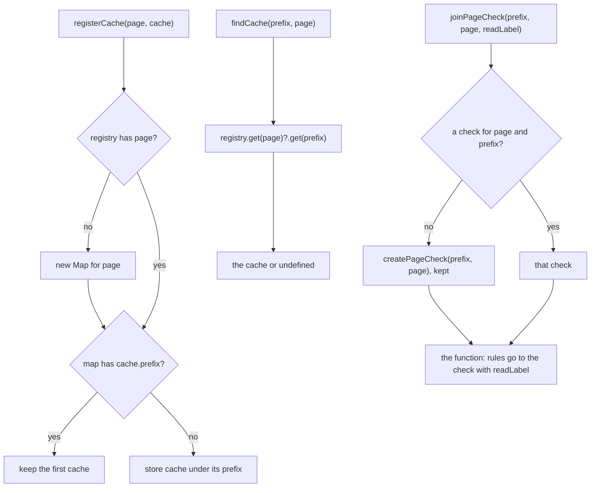

# cacheRegistry.ts

## What it does

Keeps a record, for each document, of the first cache of each prefix that writes into a style element
there. `registerCache(page, cache)` adds one and `findCache(prefix, page)` reads it back. It also keeps the
development check of each prefix in each document: `joinPageCheck(prefix, page, readLabel)` gives a cache
that writes into `page` the function that asks for the check that every cache of that prefix there shares.

## Why it exists

Some code has no engine of its own and still has to reach the cache of the page. The doc comment names a
component that a server component renders, in the browser, which needs to release a global rule that a
server sent. This file is that lookup. `cache.ts` calls `registerCache` and `index.ts` exports `findCache`.

## The logic

## The data

`WeakMap<Document, Map<string, Cache>>`: the document is the weak key, so a closed document and its caches
can be collected. It lives in shared state under the name `core.caches@1`, read through `readSharedState`,
so every copy of the core in one page sees one registry.

The checks: `WeakMap<Document, Map<string, PageCheck>>` under `core.page-checks@1`, the same way. A check
keeps the rules written since its last run, by the reader of their labels, and empties them at each run, so
it holds a cache's reader only until the next run: a cache that nothing else holds can be collected.

## What it guarantees

- The first cache registered for a prefix in a document stays; a later one never replaces it.
- A document that was never registered answers `undefined`, and two documents are kept apart.
- A lookup never creates an entry.
- It touches no browser global at module top level.
- Every cache of one prefix that writes into one document (the engine's own cache, made by `configure`, and
  an app's `createCache({ key })` under a `CacheProvider`) shares one check: the page is looked at once, and
  each problem is told once. Each cache still gives the check the rules it writes, with the reader of its
  own labels, so nothing that one cache would find is lost.
- A cache made after another one of the prefix is gone still checks the page: the check is the document's,
  not a cache's. A problem told before on that page is not told again.

## Decisions

- The shared-state name carries a version (`@1`); the code does not say more about it.
- **One check for each document and prefix, shared, rather than only the first cache checking.** A first
  cache that checks for the others would have to hold their rules and readers, and hand the check over when
  it goes; a check of the document needs neither, and the rules of every cache reach it.
- This file does not choose which caches to record. `cacheRegistry.test.ts` shows that a cache over a sheet
  in memory is not given, so that rule is applied by the caller in `cache.ts`.
