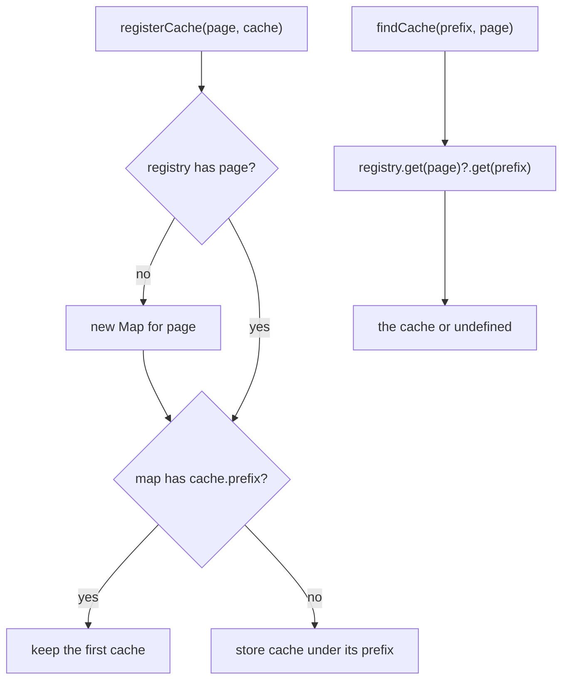

# cacheRegistry.ts

## What it does

Keeps a record, for each document, of the first cache of each prefix that writes into a style element
there. `registerCache(page, cache)` adds one and `findCache(prefix, page)` reads it back.

## Why it exists

Some code has no engine of its own and still has to reach the cache of the page. The doc comment names a
component that a server component renders, in the browser, which needs to release a global rule that a
server sent. This file is that lookup. `cache.ts` calls `registerCache` and `index.ts` exports `findCache`.

## The logic

## The data

`WeakMap<Document, Map<string, Cache>>`: the document is the weak key, so a closed document and its caches
can be collected. It lives in shared state under the name `core.caches@1`, read through `readSharedState`,
so every copy of the core in one page sees one registry.

## What it guarantees

- The first cache registered for a prefix in a document stays; a later one never replaces it.
- A document that was never registered answers `undefined`, and two documents are kept apart.
- A lookup never creates an entry.
- It touches no browser global at module top level.

## Decisions

- The shared-state name carries a version (`@1`); the code does not say more about it.
- This file does not choose which caches to record. `cacheRegistry.test.ts` shows that a cache over a sheet
  in memory is not given, so that rule is applied by the caller in `cache.ts`.
