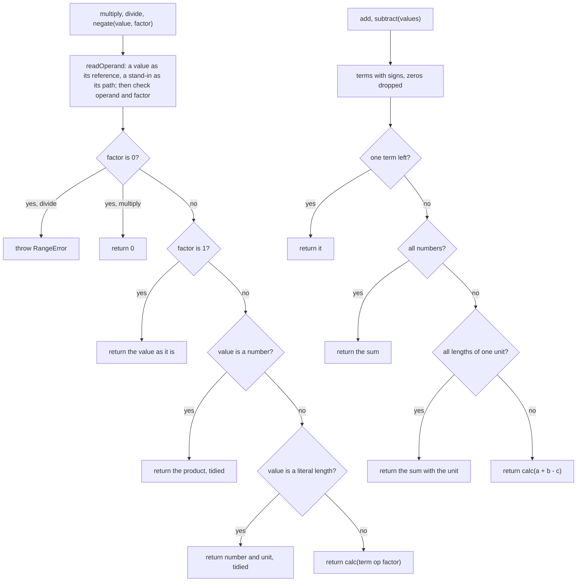

# calc.ts

## What it does

Arithmetic on tokens: `multiply`, `divide`, `add`, `subtract` and `negate`. Each takes numbers and CSS
values (an `Operand` is a string or a number, and a value of `useStyleValue` is taken as one) and returns a number when it can, a literal length when it can,
and otherwise one `calc(...)` string for the browser to compute.

## Why it exists

A token is a reference such as `var(--u-space-2)`, so the engine cannot compute `theme.space[2] * 2`
itself. These helpers give the author one way to write it that stays a plain number or length wherever the
values are known, and becomes a `calc()` only where it has to. They are exported by `index.ts`, used by
`serialize.ts` and re-exported by `packages/react-native/src/index.ts`.

## The logic



`toTerm` turns a number into `Npx` and puts parentheses around an operand that is already one whole `calc(...)`
(`unwrapCalc` checks that the first parenthesis closes only at the end, so `calc(a) + calc(b)` is not one
calc). `tidy` rounds to six decimals and adds `0` so that `-0` becomes `0`. A stand-in from `keyframes` is
read as its path before anything else, and a value of `useStyleValue` as its reference (`readOperand`): the
helpers return text for it, never a value object, so what a style gets is a string.

## The data

An operand is a value of `useStyleValue` (`liveValue.ts`), read as the reference to its variable,
`var(--<prefix>-value-<id>, <first>)`, so it is carried into a calc like a token; or a number, a literal length (`'8px'`, `' 1.5REM '`, `'50%'`, `'.5em'`, with the unit
lowered), or any other string, which is carried into a calc as it is. Examples from `calc.test.ts`:

```
multiply('var(--u-space-2)', 2)      -> 'calc(var(--u-space-2) * 2)'
add('8px', '4px')                    -> '12px'
add('8px', '1em')                    -> 'calc(8px + 1em)'
add(space, -4)                       -> 'calc(var(--u-space-2) + -4px)'
```

## What it guarantees

- Numbers in, a number out; float noise (`0.1 * 3`) is removed.
- Literal lengths of one unit stay literal; a number next to a string is a length in px.
- A factor of 1 returns the operand itself; a factor of 0 returns `0` (`divide` by 0 throws a `RangeError`).
- A non-finite number, or a value that is not a string or a number, throws before any text is made. An
  `alpha()` color is rejected with a `TypeError`.
- A calc inside a calc is wrapped in parentheses, never flattened.

## Decisions

- Literal folding is done only for a plain `number` plus `unit` pattern; a string such as `'3.'` or `'8'`
  with no unit is not a length and goes into a calc (`calc.test.ts`).
- Zero terms are dropped from a sum, so `add(space, 0)` is `space`.

## Limits

- Units are never converted: `8px + 1em` stays a calc. Strings such as `'1px 2px'` or `'10px + 1em'` are
  passed into the calc without parsing, so the result may be invalid CSS (`multiply('1px 2px', 2)` gives
  `calc(1px 2px * 2)`).
