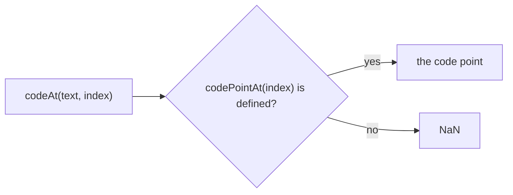

# codeAt.ts

## What it does

`codeAt(text, index)` returns the code point of `text` at `index`, or `NaN` past the end.

## Why it exists

The hand-written readers of the engine compare codes in loops. `codePointAt` returns `undefined` past the
end, which would need a check at each comparison; `NaN` makes every comparison false, so a loop stops on its
own. It is shared by `scanHtml.ts`, `scanStyleText.ts`, `serialize.ts` and `variables.ts`.

## The logic

## What it guarantees

- It is pure and never throws, for any index.
- At the high half of a surrogate pair it gives the whole code point; at the low half it gives the lone low
  surrogate (the behaviour of `codePointAt`).

## Decisions

- `NaN` stands for "none" because every comparison with it is false (the doc comment).
- `hash.ts` has its own private `codeAt`, which masks to one byte; it does not use this file.
