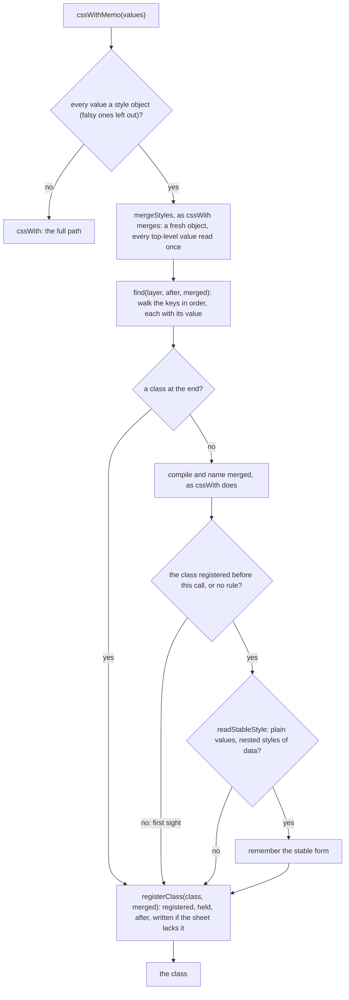

# contentMemo.ts

## What it does

`createContentMemo()` makes the memo of a cache's `hasStyleMemo` option: a tree that maps the contents of
a merged style, with the layer and the class it is made after, to the class name the cache made for it.
`find` walks a style down the tree and gives the class at its end; `remember` makes the steps of a style
and puts its class there. `readStableStyle` decides whether a style can be remembered, and gives the
form of it that is compiled and remembered (itself, or a copy when it has nested styles).

## Why it exists

Real code rarely gives the engine the same object twice. A component writes a condition in its style
(`({ isMobile }) => ({ fontSize: isMobile ? 12 : 48 })`), so each render makes a new object with one of a
few contents. Without the memo the cache compiles that object to its rules and hashes them, and only then
finds that it has the class. The memo finds the class from the contents, before the compile. It is a
cache option, off by default (`cache.md`, `docs/options.md`): with it off the cache makes no memo and
takes the path it took before, chosen once when its compilers are made.

## The logic

One step of a walk is a key and its value: `node.next.get(key).get(value)`. A nested style is a step of
its key with the value `ENTER`, then its own steps, then the step `LEAVE`, `LEAVE`. A memo is full at
`CONTENT_STEP_LIMIT` steps: the next `remember` empties it first. A style is remembered the second time
its class is made (the class is in `registered` before the call), never the first, so a style that never
comes again costs a failed walk and no remembering.

## The data

- `Node`: `next` (key -> value -> node) and `className` (set at the end of a remembered style; `''` for a
  style with no rule).
- `roots`: layer -> `after` -> the root node of that pair. `steps`: the number of nodes made.
- A memo is made for each set of style options of a cache (`WrittenAs.contents`, so `withStyleOptions`
  views have their own), and only when `hasStyleMemo` is on and neither the development checks nor value
  repair are.

What the class of a call depends on, and how each is part of the key: the merged style (its keys in
order and their values, nested styles, the label, which `mergeStyles` makes from the `label` option and
the labels of the styles) is the walk; the layer and `after` are the root; the style options
(`hasColorFallbacks`, `hasVendorPrefixes`) are the memo itself, one for each `WrittenAs`; the prefix,
suffix, `hasLabels`, `hasLayers` and the scoping are the cache's, which owns the memo. Value repair reads
the values of the tokens (`readValue`), which change, so with it there is no memo.

## Why two styles never share an entry

There is no text key. A walk compares each key and each value as a `Map` compares keys (SameValueZero):
a key is a string; a value is a string, a number, `undefined`, `null`, `false`, or the step into a nested
style. So `1` and `'1'` are two values; `{ a: 'b;c:d' }` is one key with one value and `{ a: 'b', c: 'd' }`
is two keys; keys in another order are other steps; a nested style's keys sit between `ENTER` and `LEAVE`,
objects no key is equal to. Two styles reach the same node only when they have the same keys, in the same
order, with the same values, and so merge, compile and name to the same class.

The one equality that is not identity of text: SameValueZero takes `-0` as `0` (and `1.0` is `1`, one
number). The compiler reads a number only as `String(value)` and `value !== 0`, which are the same for
`-0` and `0`, so their rules and class are the same. `NaN` is one value, written `NaN`.

## What it guarantees

Each line is a case that would make the style not apply, with the test that fails if the memo got it
wrong (each was run against a deliberately broken memo and failed; `cache.memo.test.ts`,
`cache.memo.page.test.ts`, `contentMemo.test.ts`, the `createInstance.memo.test.ts` of the css package,
and the `styleMemo` tests of the React binding):

1. A memo answers for one cache, and one set of style options: two caches, two views over one cache,
   and a fresh cache all write their own rules (`answers for one cache only`, `answers for one view
   only`). Because every call registers its class, even a memo shared by mistake would write the rule;
   the tests fail on the wrong class of another view.
2. A rule the cache let go: the memo holds class names, and every call goes through `registerClass`,
   which writes the rule when the sheet does not have it. A held class is never remembered, and a class
   the memo names is registered for good, so no holder can remove it. `flush()` of the css package makes
   a new cache, with a new memo (`writes the rule of a held class let go`, `keeps for good a class it
   named`, `writes the rule again after flush`, `marks the variables of a rule as the full path does`).
3. A page: extraction reads the classes of the page, which every call registers (`serves every page`).
4. Hydration: a page's rule is marked as written when the cache reads the page; the memo starts empty and
   changes nothing of that, and after the page's element is removed the cache does what it did without
   the memo (`writes no second rule`, `does what the cache does without it once the page loses the
   element`).
5. A sheet replaced: a cache keeps its sheet for its life; `flush()` makes a new cache (2).
6. A number against a string (`1`, `'1'`, `0`, `'0'`, `-0`, `1.0`, `' 1 '`): `tells a number from the
   string of its text`, `gives a number and a string of the same text what the full path gives each`.
7. Key order: `tells keys in another order apart`, `gives keys in another order what the full path
   gives each order`.
8. Separators: `joins no text`, `gives a value that looks like more declarations what the full path
   gives`.
9. The layer, the label, `after` and the views: `keeps a style apart for each layer and each class it is
   made after`, `keeps each layer, label and class to come after apart`, `answers for one view only`.
10. What writes no rule: the class is that of the rules, and `registered` holds the style of the call,
    merged afresh on every call as without the memo (`gives the style of the last call to a later
    merge`).
11. What is not a plain value takes the full path: `alpha()`, a live value, an object with its own
    `toString`, a list, a key of the prototype, a symbol key, `__proto__`; a getter is read as often as
    without the memo (top level: once, by `mergeStyles`; nested: never by the memo, which reads
    descriptors) (`takes the full path for what is not a plain value`, `reads a getter as many times as
    the full path does`, `calls no getter of a nested style`).
12. The cap: `is emptied when it holds the most steps it may`, `names the right class after it was
    emptied, with the rule in the sheet`.
13. The development checks and value repair: no memo, every call checked (`is not used with the
    development checks`, `is not used with value repair`). Off by default, no memo is made (`is off by
    default`).
14. On generated styles (400 styles, 2000 calls, three sets of options) every class, rule, registered
    style and page is that of the full path (`gives every class, rule, registered style and page of the
    full path`); a React tree renders the same markup and CSS with it on and off, on the server and in a
    document.

## Decisions

- A tree of `Map`s, not a text key. A key built as text (the keys and values with their lengths) was
  correct but slow: the `Map` lookup of a new text hashes all of it, about 300 to 500 ns for a small
  style, more than half of what it saved. The tree looks up strings the program already holds (style
  keys and values are mostly literals, whose hash is kept), about 100 ns for a small style, and needs no
  proof that a separator cannot occur.
- The merge is kept on every call: `registered` gets a fresh merged style as without the memo, so a
  later merge of the class reads the style of the last call, and a style object changed after a call is
  never seen through the memo. Only the compile and the hash are saved.
- The walk is of the merged style, not of the call's objects: `mergeStyles` read each top-level value
  once, so the class and what is remembered come from one read. A nested style is the call's own object:
  the compile reads it as the full path does, and the memo reads it through its descriptors (a getter is
  never called, and a style with one is not remembered), so what is remembered is the data that was
  compiled. A getter is called as often as without the memo.
- Emptied when full, not the oldest first: a tree has no order of entries, and emptying is one
  assignment.
- Remembered on the second sight, not the first. Remembering on the first sight made every new style
  pay a copy of its nested styles and a node and two maps for each step of its tail: in the comparison
  (Docker, one CPU) a new large style went from 34 us to 89 us, a new small one from 4.1 to 5.1 us, and
  48 elements over a fresh cache from 545 to 661 us. Whether the class was registered before the call is
  known for free once the class is named, and a style that comes once is never remembered. Rejected
  before it: a limit of 256 values for a key at one place of the tree, which helped a key with a new
  value on every call but not a new large style, and needed exemptions for the label and the root.
- Off by default, and chosen once: without the option the compilers of a cache call `cssWith` as before,
  with no check on the way.

## Measured

Local files `classes-contents.bench.ts` (core), `class-contents.bench.ts` (css) and
`string-props.bench.ts` (react); the figures, before this change, with the memo off and on, are in
`docs/benchmarks.md` and the release notes of 0.4.0.

## Limits

- A nested style that is a `Proxy` whose descriptor trap and get trap disagree is not detected.
- A style seen for the first time pays a failed walk and a lookup of its class on top of the full
  path, and the second time it pays the remembering; a style whose contents never repeat pays the walk on
  every call.
- Class names and sheet entries among the values, lists, `alpha()` values, live values and held classes
  are not covered.
