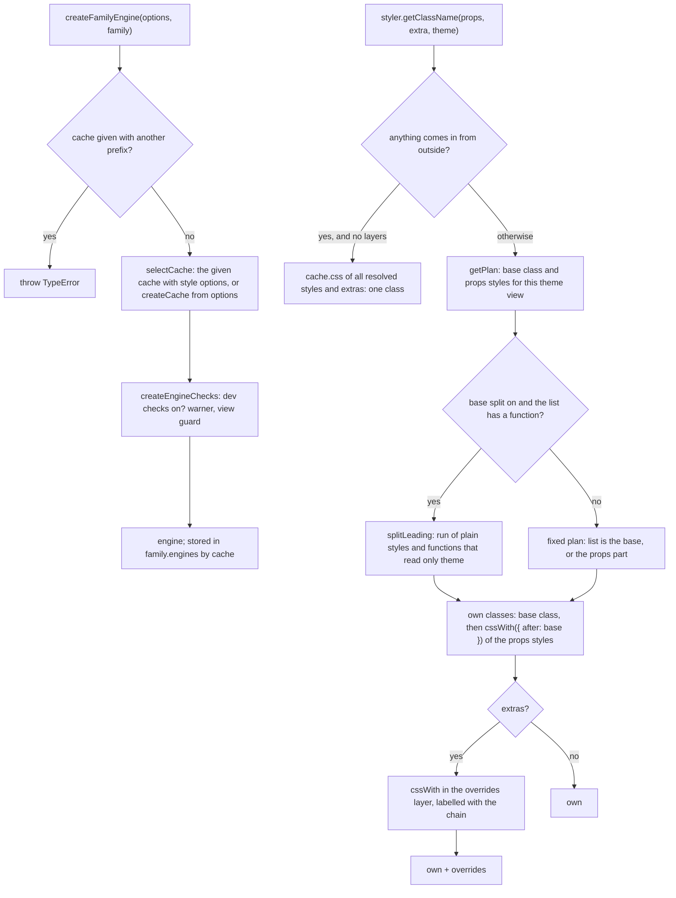
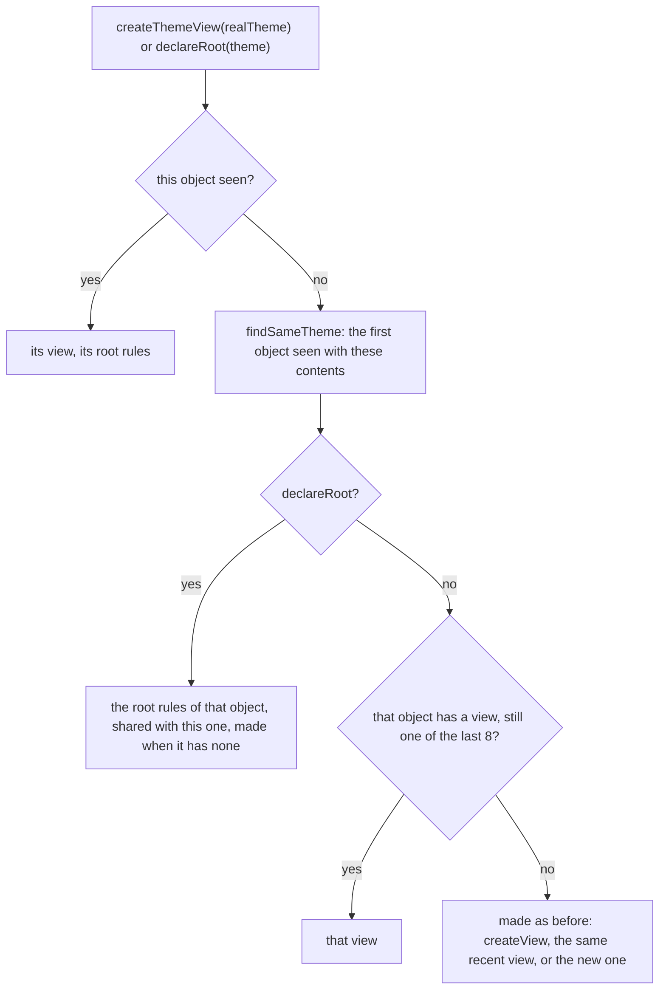

# createEngine.ts

## What it does

`createEngine(theme, options)` and `createLazyEngine(options)` make an `Engine`: the object a binding
builds on. An engine owns one cache and one base theme, and gives theme classes (`themeClass`, `themeId`,
`declareRoot`, `readThemeText`), theme views for style functions (`createThemeView`), sheets
(`createSheet`), the class logic of a styled component (`createStyler`), `keyframes`, global styles
(`resolveGlobal`, `insertGlobal`) and a second engine over another cache (`withCache`). The lazy engine has
no theme yet and takes one from `setTheme` or from the first theme it is asked about.

## Why it exists

The cache knows classes and rules but nothing about tokens or components. The engine joins them: it makes
the tokens of the base theme (`createTokens`), turns a theme into variables and a theme class, and decides
how a styled component's style list becomes classes. All three bindings need the same logic, so it lives in
core and the bindings stay thin. It is used by `css.ts`, `index.ts` and every binding.

## The logic

`sync()` is the key step for the theme: when the family's base theme differs from the one the engine's tokens
were made from, it takes the tokens of the family for it (`readFamilyTokens`: made once for each theme
object and prefix), empties the view caches, registers the `@property` rules and the token values (for value
repair), marks the always-declared variables as used and counts a new `version`.
Everything that depends on the base theme calls `readTokens()` first.

Theme classes and root rules are made once for each theme object and colour scheme (a `WeakMap` of
`Map`s): `themeId` adopts the theme as base if there is none, declares its variables, and calls
`createThemeClass`; `declareRoot` also calls `cache.insertRoot` on every call, so the last theme wins. A
theme object that `declareRoot` has not seen shares the `Map` of the first object seen with the same
contents (`family.findSameTheme`, `sameTheme.ts`): the same declarations and the same id, without
declaring the tokens again.

`createThemeView(realTheme)` makes the view where each token is a `var(--name)` reference; a view equal to
one of the last 8 (`isSameView`) is that one, so a component does not render again when only variable
values changed. A theme object it has not seen first takes the view of the first object seen with the same
contents, when that view is still one of the last 8: the view that making it again would find. Otherwise
the view is made as before.

`createStyler` builds, for one component: its label (`name-slot`, or the given `label`), the style list
(inherited, own label, styles), and the labels of the whole chain. A function style is called with the
props and the guarded theme view, and its result is checked in development (`checkStyleResult`: a string
passes, a number, `true` or a function warns once and becomes `undefined`).

## The data

- `EngineFamily`: `{ theme, givenTheme, engines: WeakMap<Cache, Engine>, tokens, findSameTheme }`, shared
  by the engines made with `withCache`, so `setTheme` of either is the base of both, and the engine of a
  fresh cache finds the themes of the same contents that the others saw. `findSameTheme` keeps, weakly, what
  each theme object was found to be, and the last 4 themes of distinct contents for the life of the family
  (`sameTheme.ts`). `givenTheme` is only what was given on
  purpose, never one adopted from a provider. `tokens` holds, for each prefix, the tokens last made with
  the theme object and the token options they were made from: one entry for each prefix, replaced when
  the base theme is another object, whatever the number of styles or caches.
- `Plan`: `{ baseClass, leading, propsStyles }`, one per theme view (`WeakMap`).
- `labelStyles`: a shared `WeakSet` (`core.label-styles@1`) of the `{ label }` objects a styler puts in its
  list, so a wrapper finds the labels of the components it wraps, also from another copy of the core.
- Token signature: a hash of `rawKeys`, `lengthKeys`, `modes`, `registered` and `alwaysDeclare`, `''` when
  none is set; it goes into the options stamp (`fingerprint.ts`).

## What it guarantees

- Nothing is written when an engine or a sheet is made: entries are lazy and a rule is written when first
  used; a keyframes name and a global handle exist before any theme.
- A lookup that needs the theme shape before there is a theme throws `NO_THEME_MESSAGE`.
- A prefix in the options that differs from the given cache's prefix throws a `TypeError`.
- `createEntries` and `adoptSheet` are lazy records; `adoptSheet` gives one record for each record given.
- With the checks off, a style function gets the view itself and no wrapper is made.
- `withCache(cache)` gives the same engine for the same cache (`family.engines`).

## Decisions

- A component's list is split by position into a base class (plain objects and functions that read only the
  theme, made once per view) and a props class (made for each render, written after the base). Reading is
  tracked by a proxy over the props (`callTracked` in `styleBase.ts`). With no layers there is no order
  between classes, so anything that comes in is merged into one class.
- A view is planned once with the props of the first call; a function that read no prop then takes the
  same path for every later call with that view.
- Engine options that only a cache holds (`CACHE_OPTIONS`: `suffix`, `hasLabels`, `hasLayers`, `hasPruning`,
  `hasScope`, `hasStyleMemo`, `speedy`, `nonce`) are ignored, with a warning, when a cache is given: the cache decides.
  `nonce` is passed to the cache the engine makes, for its style element and the tags made from it.
- An options object that still has `hasRuleText` (renamed to `speedy` in 0.3.0, with the opposite meaning)
  is warned about once in development by `warnRenamedOption`, before the cache is chosen, with a cache or
  without; the engine passes its cache options to `createCache` one by one, so the cache never sees the old
  name and does not warn again.
- The tokens of the base theme are made once for each theme object and prefix, and shared by the engines
  of the family (`readFamilyTokens`): the engine of a fresh cache, a `CacheProvider`'s for one render,
  made them again from the same object with the same options, and gets the same names and references
  (`makes the tokens of the base theme once for a prefix`). It relies on what the engine assumes already,
  that a theme object is not changed after it is used. A cold render of 48 fixed elements went from 229 to
  172 us, of nested providers from 377 to 316 us (sandbox, five rounds); `refs` is one object for those
  engines.
- Warning about unmatched `modes`, `registered` and `alwaysDeclare` paths happens in `sync()`, with checks on.
- With checks on, the tokens are made with `reportKeyword`: a token declared with a CSS-wide keyword as its
  value is warned about once for each path (the warner keys it `keyword:<path>`), naming the path, the
  keyword and the variable, and saying to write the keyword in the style or to give the path the mode
  `raw`. The tokens of a family are made once for each prefix, so the first engine of that prefix tells.
- A theme is recognised by its contents for the root rule and the view only, the work of every render of a
  provider. `themeId` and `findThemeIds` stay by object: `findThemeIds` answers which classes were made for
  that very object, and sharing them between objects of the same contents would change what it answers.
  On a design system's home page, whose provider made its theme in each render, the root rule and the view
  were made in every render (about half of its time on a server); now a new object of the same contents
  costs a comparison (`sameTheme.md`).

## Limits

- `checkStyleResult` writes its warning with `console.warn` and a module-level set, not through the engine's
  warner, so it does not use the `[prefix]` of `createWarner` the same way (the prefix is added in the
  message by hand) and the set is shared by every engine.
- A wrapped component with function styles has no single class, so it cannot be a selector (`css.ts`).
