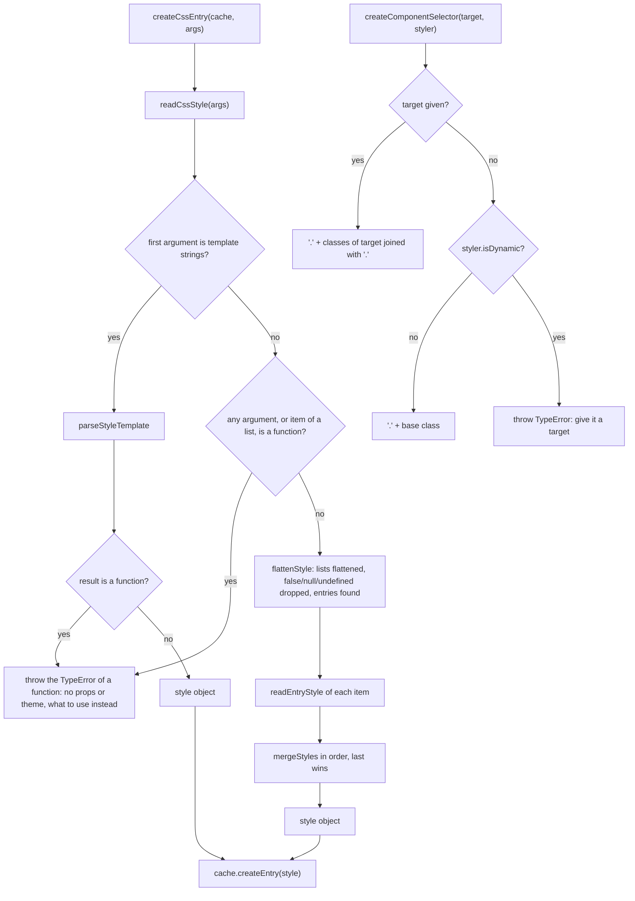

# css.ts

## What it does

The argument handling of `css()` and `styled()` for every web binding. It reads the arguments of a call
into one style object (`readCssStyle`), turns them into a sheet entry over a cache (`createCssEntry`), reads
the arguments of a styled call (`readStyleArguments`), and makes the `toString` that lets a styled
component be used as a selector (`createComponentSelector`).

## Why it exists

React, React Native and Vue all accept the same arguments to `css()` and `styled(tag)(...)`: a tagged
template, style objects, results of `css()`, sheet entries, lists, and falsy values. The reading of those
arguments, and the errors for what a call cannot take, must be the same everywhere, so it lives in core.
It is exported by `internal.ts` (`@umber-style/core/internal`), and imported by `createStyle.ts`, `createStyle.server.ts`, `styled.ts`,
`styled.server.ts` and `styledParts.ts` in `packages/react`, `createStyle.ts` in `packages/react-native`,
`createStyle.ts` and `styled.ts` in `packages/vue`, and `createInstance.ts` in `packages/css`
(`rejectFunctions` only, for the error of a function).

## The logic

`readStyleArguments` is the styled-side version: a template becomes one style (an object, or a function of
props when an interpolation is a function), otherwise the arguments are flattened with `flat(Infinity)`.
The function rule differs on purpose: `css()` has no props, so it rejects functions; `styled` accepts them.

## What it guarantees

- A template given to `css()` with a function interpolation, and any function among the other arguments,
  throws one `TypeError`, made by `createFunctionError`: it names the caller (`css()` or the one given),
  says that there are no props or theme to call the function with, and says what takes one instead: a
  styled component's style function for a value of the props, an entry of
  `StyleSheet.create((theme) => ...)` given to the `style` prop for a value of the theme (#87). The
  bindings' `css()` and `css` of `@umber-style/css` reach it through `readStaticTemplate` and
  `rejectFunctions`, so the message is the same on every path. It never suggests a `css` prop: there
  is none (#86).
- Equal styles give the same class: the entry is made by the cache, which writes its rule when the entry
  is first used. Its `name` and `styles` can be read without writing the rule.
- A string argument and an entry that is only a class name throw, through `readEntryStyle`.
- The selector of a styled component is always a class every element has, or an error; it never gives a
  class that only some elements carry.

## Decisions

- A component with function styles has no single class, so `${Button}` as a selector needs a `target`;
  the error message says how to give one.
- A `target` with several classes becomes a selector with all of them (`.a.b`), spaces replaced by dots.
- The framework-specific parts stay out: a binding passes `findEntry` to find entries a framework merged
  into an object.

## Limits

- `readStyleArguments` does not validate the entries; validation happens later, where the styles are read.
