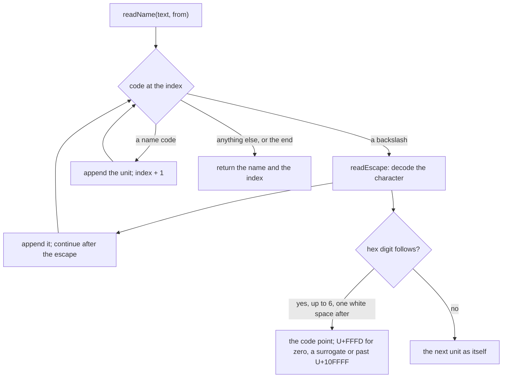
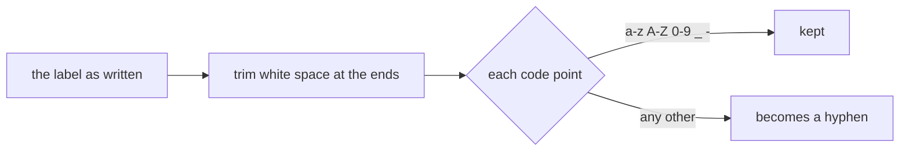

# cssName.ts

## What it does

Reads a CSS identifier, the name of a class or of a variable, out of text: `isNameCode(code)` says
whether a code point can be in a name as it is, and `readName(text, from)` returns the name that starts at
`from`, with its escapes decoded, and the index after it.

## Why it exists

The browser cache learns which rules a server already wrote by scanning the text of the server's style
elements (`scanStyleText.ts`). The name it records for a class must be the name the cache keys that class
by. The first reader accepted only `a-z`, digits, `-` and `_`, so `.soroush-Typography-1p2bgvv` was read as
`soroush-` and never recorded: after hydration every class with an upper-case letter in its label was
written a second time. One reader, here, is what the scanners share.

## The logic

## The data

A name code is `a-z`, `A-Z`, `0-9`, `-`, `_` and every code point `>= 0x80`. An escape is a backslash
followed by one to six hex digits (and one optional white space that ends them), or by any other
character, which stands for itself.

## What it guarantees

- Upper-case and non-ASCII letters are part of a name.
- A name ends at the first code that is not a name code and is not the start of an escape: a space, `.`,
  `:`, `,`, `>`, `+`, `~`, `[`, `{`, `)`.
- An escape that is not a character (zero, a surrogate, past U+10FFFF) gives U+FFFD.
- It is one pass, with no pattern that backtracks.

## The label of a class

`toLabelPart(label)` is the other half of the file: the part of a class name that a label becomes. White
space at its ends is trimmed, then each code point outside `a-z`, `A-Z`, `0-9`, `_`, `-` becomes `-`, one
for one, with no collapsing; a label empty once trimmed is `''`. It is narrower than `isNameCode` on
purpose: reading must accept every valid CSS name, writing keeps to ASCII so that no reader needs an escape.
It is used by `nameClass` in `cache.ts`; `createLabel`'s kebab-cased `name` and `slot` pass through it too
(`Card.Title` is `card.title`, then `card-title`).

## Decisions

- `findMissingStyles.ts` keeps its own copy of these readers: it imports nothing at run time, because the
  end-to-end tests send its compiled text into a page. A comment there points here; change them together.
- `serialize.ts` has an `isNameCode` of its own for reading units. It is a different job and is left alone.
- A backslash at the very end of the text is an escape of nothing: the index goes one past the text.

## Limits

- Only the class and variable names that an engine or a browser writes are read; it does not check that a
  name is a valid identifier (one may start with a digit here).
