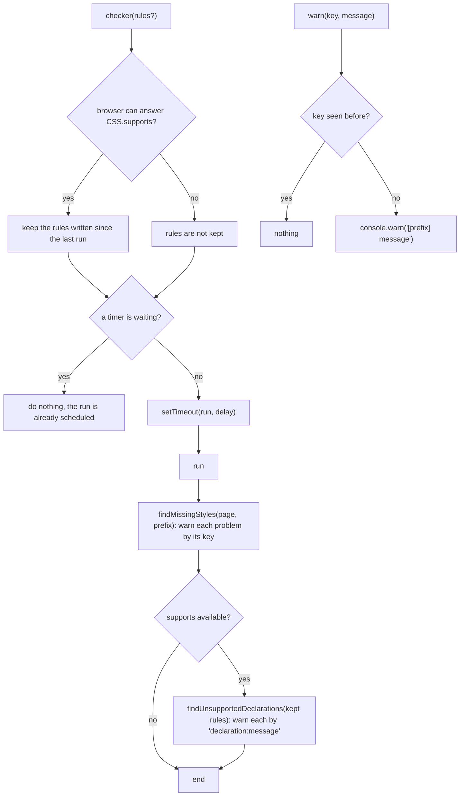

# devChecks.ts

## What it does

The development-time warning machinery. `isDevelopment()` and `isProduction()` read
`process.env.NODE_ENV`, `createWarner(prefix)` makes a function that warns once for each key, and
`createDevChecker(prefix, delay, page, readLabel)` makes the function that schedules a check of a page after
the rules have stopped arriving.

## Why it exists

The engine writes rules into a page while it renders, and some mistakes only show in the result: a class
used in the markup that has no rule in the sheet (`findMissingStyles`), and a declaration the browser does
not support (`findUnsupportedDeclarations`). Checking at each insertion would be noisy and slow, so the
checker waits for a burst to end, runs once, and never warns twice about one problem. The checks are for
development only. `cache.ts` builds the checker and the warner, `createEngine.ts` builds its own warner,
`sharedState.ts` and the React server files read `isDevelopment`, and `index.ts` exports `isDevelopment`.

## The logic

The timer is not restarted by later calls: `timer ??=` means the first call of a burst sets the delay
(250 ms by default), and the run takes every rule written until then.

## What it guarantees

- A warning is written once for each key for the life of the warner, and always starts with `[prefix] `.
- Rules are kept only when `CSS.supports` can be asked; otherwise nothing accumulates.
- `isDevelopment()` is false and `isProduction()` is true where `process` does not exist.
- At module top level nothing touches a browser global (`document` appears only as the default of a
  parameter, read when the checker is made).

## Decisions

- Missing-style problems are deduplicated by `problem.key`; unsupported declarations by their message with
  a `declaration:` prefix, so the two kinds cannot collide.
- `process` is declared locally, so the core needs no type package for it (the comment in the code).
- The unknown-environment answer differs by question: not development, and production.

## Limits

- The run takes the page at the time the checker was made, not at the time of the run.
- Where the browser cannot be asked (no `CSS.supports`, or jsdom) unsupported declarations are not checked.
