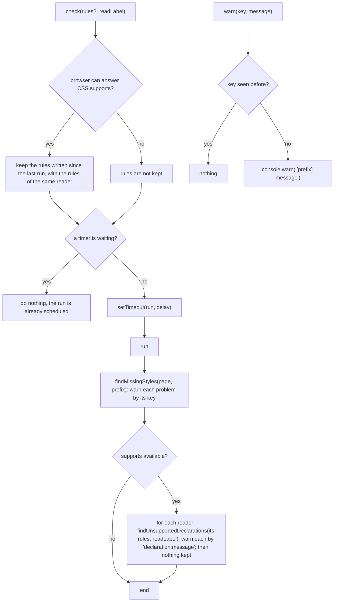
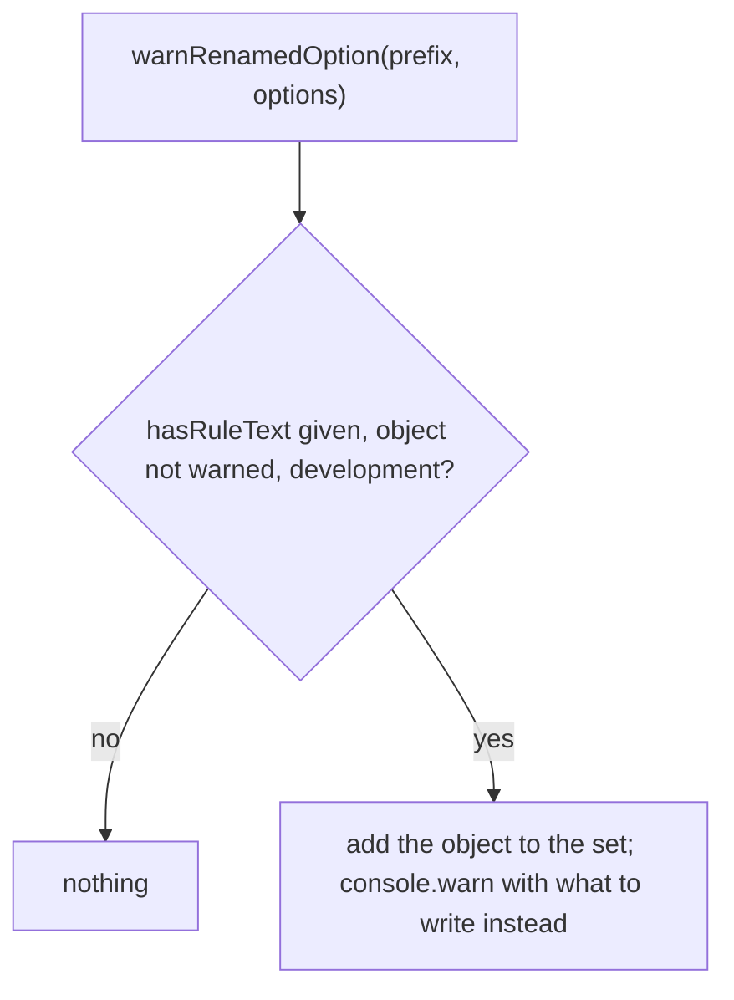

# devChecks.ts

## What it does

The development-time warning machinery. `isDevelopment()` and `isProduction()` read
`process.env.NODE_ENV`, `createWarner(prefix)` makes a function that warns once for each key, and
`createPageCheck(prefix, delay, page)` makes the check of a page that schedules a run after the rules have
stopped arriving; each call gives the rules just written and the reader of the labels of their classes, so
the caches of one prefix that write into one page can share it (`joinPageCheck` of `cacheRegistry.ts`).
`createDevChecker(prefix, delay, page, readLabel)` makes a check of its own, for one reader. `warnRenamedOption(prefix, options)` warns, in development, about an
options object that still has `hasRuleText`, the name of `speedy` before 0.3.0.

## Why it exists

The engine writes rules into a page while it renders, and some mistakes only show in the result: a class
used in the markup that has no rule in the sheet (`findMissingStyles`), and a declaration the browser does
not support (`findUnsupportedDeclarations`). Checking at each insertion would be noisy and slow, so the
checker waits for a burst to end, runs once, and never warns twice about one problem. The checks are for
development only. `cache.ts` builds the checker and the warner, `createEngine.ts` builds its own warner,
`sharedState.ts` and the React server files read `isDevelopment`, and `index.ts` exports `isDevelopment`.

## The logic

The timer is not restarted by later calls: `timer ??=` means the first call of a burst sets the delay
(250 ms by default), and the run takes every rule written until then.

`warnRenamedOption` warns once for each options object (a `WeakSet` of the objects warned about), so an
object that one function hands to another as it is gets one warning. Its message says what to write for the
value given (`hasRuleText: false` is `speedy: true`) and that the value is not read. Nothing is warned about
outside development, nor for `hasRuleText: undefined`.

## What it guarantees

- A warning is written once for each key for the life of the warner, and always starts with `[prefix] `.
  The warner of a check shared by the caches of a page lives as long as the document, so a problem is told
  once on that page, whichever cache found it.
- The rules of a reader are asked about with that reader: the class of each cache is named with its label.
- Rules are kept only when `CSS.supports` can be asked; otherwise nothing accumulates.
- `isDevelopment()` is false and `isProduction()` is true where `process` does not exist.
- At module top level nothing touches a browser global (`document` appears only as the default of a
  parameter, read when the checker is made).

## Decisions

- Missing-style problems are deduplicated by `problem.key`; unsupported declarations by their message with
  a `declaration:` prefix, so the two kinds cannot collide.
- `process` is declared locally, so the core needs no type package for it (the comment in the code).
- A warning that only development gives is written in a branch whose condition starts with what
  `isDevelopment()` reads, written out: `typeof process !== 'undefined' && process.env != null &&
  process.env.NODE_ENV !== 'production' && isDevelopment()`. A bundler that writes `"production"` in place
  of `process.env.NODE_ENV` folds that to false and leaves out the branch, and the text and functions only
  it uses; a call of `isDevelopment()` alone is a call it cannot see into. The condition is true exactly
  when `isDevelopment()` is, and throws nowhere it would not (no `process`, no `env`). It is used by
  `warnRenamedOption` here, `registerCopy` of `sharedState.ts`, `state()` of `state.ts` and the default
  style of the React binding. Not done for the development checks (`hasDevChecks`, the engine's checks of
  results): `hasDevChecks: true` turns them on in any build, a production one too, so they are reachable
  there. Folding them the same way would leave about 4 KB gzipped out of a small React app, and would turn
  off what `hasDevChecks: true` asks for in a production build; that is a change of behaviour, not made.
- The unknown-environment answer differs by question: not development, and production.

## Limits

- The run takes the page at the time the checker was made, not at the time of the run.
- Where the browser cannot be asked (no `CSS.supports`, or jsdom) unsupported declarations are not checked.
