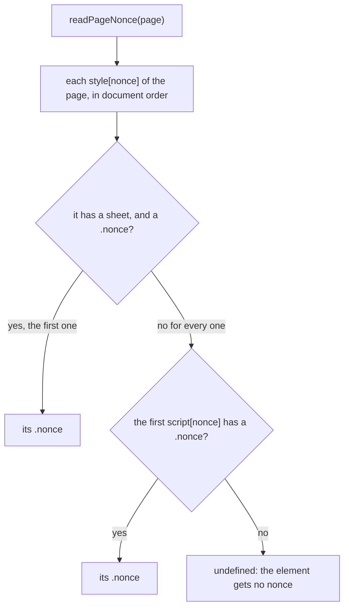

# documentNonce.ts

## What it does

`readPageNonce(page)` gives the nonce of a page in the browser: the `.nonce` of a style element that the
policy let in (it has a sheet), else the `.nonce` of the first script that carries one, else `undefined`.
The cache gives it to the style elements it makes for itself when it was given no nonce
(`createOwnSheet` of `cache.ts`), and the element of the live values does the same (`liveValue.ts`). The
React binding reads it after the nonce it recorded at hydration (`readDocumentNonce` of `NonceStyles.tsx`,
through `@umber-style/core/internal`), so both read the page by one definition.

## Why it exists

A page sent under `style-src 'nonce-<n>'` with a new nonce for each request refuses every style element
without that nonce. The browser's copy of the engine is a bundle made once for every request, so no nonce
can be put in it, and the cache of a browser had none: the element it makes for a class that the first
HTML did not have (after a client-side navigation, a change of props, a component that mounts later) was
refused, and the class unstyled (#71). The page itself carries the nonce, on what the server sent with it.

## The logic

## What it guarantees

- A style element with no sheet is never a source: one the policy refused (injected with a nonce it does
  not allow) holds no rule, and gives no nonce either.
- It reads the `.nonce` property, which the browser keeps when it hides the attribute of a page sent with
  a policy, and an empty one counts as none.
- It reads the page it is given, and only when called: nothing at module top level.

## Decisions

- **From elements, not from a meta tag or an attribute.** A value an injected element could carry
  without being applied is not trusted; a style element is a source only once the policy applied it. A
  script is taken as it is: under a policy with a nonce the page's scripts carry it, and a wrong one can
  only make the element refused.
- **Style elements before scripts.** A style element that the policy applied proves the nonce is the one
  of styles; a script's is the one of scripts, the same in the policies of the frameworks.
- **Only the engine's own rules go into an element made with it**, so a nonce read from the page lets in
  nothing that the policy did not allow already.
- **In the core, beside the sheet.** The sheet of the cache is the core's; the React binding adds the
  nonce it recorded at hydration in front of it. One definition, rather than a copy in each.

## Limits

- A page where nothing with a nonce has been applied or parsed yet gives none: the cache reads it once,
  when its sheet makes its first element.
- A policy that allows styles by hash (`style-src 'sha256-...'`) has no nonce to read, and allows no style
  made at run time.
