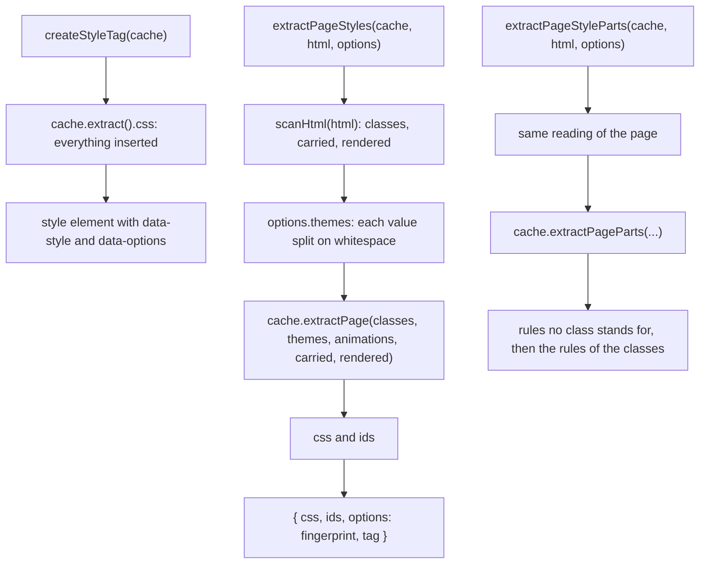

# extractStyles.ts

## What it does

Turns what a cache holds into style elements for a server render. `createStyleTag(cache)` gives one ``.

## What it guarantees

- A page's CSS does not depend on what else the cache holds, on the order pages were rendered in, or on
  pages rendered at the same time; the cache is not changed (the doc comment).
- Global rules inserted for the app are in every page; those of a `Global` component are in a page only when
  its HTML carries a style element or a marker that names the set.
- `<style href precedence>` elements already in the HTML are not written again.
- `parts.css` joined in order equals the CSS of `extractPageStyles`.

## Decisions

- `createStyleTag` holds no list of ids: the browser reads the rules themselves.
- The unscoped `createStyleTag` stays for static pages; the doc comment says a cache that serves many pages
  should use `extractPageStyles`.

## Limits

- Class names that a script adds at run time are not in the HTML, so their rules are not in the page; the
  `themes` and `animations` options exist for uses the scan cannot see.
