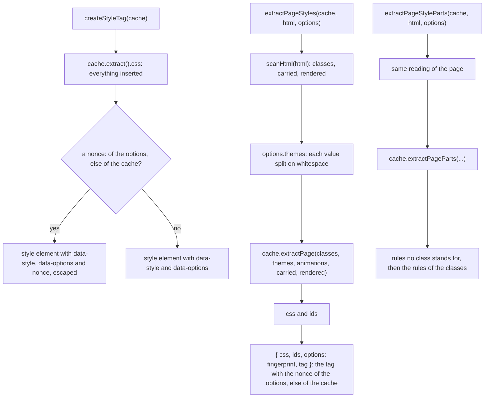

# extractStyles.ts

## What it does

Turns what a cache holds into style elements for a server render. `createStyleTag(cache)` gives one ``, the nonce last and only when
there is one.

## What it guarantees

- A page's CSS does not depend on what else the cache holds, on the order pages were rendered in, or on
  pages rendered at the same time; the cache is not changed (the doc comment).
- Global rules inserted for the app are in every page; those of a `Global` component are in a page only when
  its HTML carries a style element or a marker that names the set.
- `<style href precedence>` elements already in the HTML are not written again.
- `parts.css` joined in order equals the CSS of `extractPageStyles`.
- A nonce is in the tag only: never in `css`, `ids` or `options`, so it changes no class name, hash or stamp.
  `&`, `"`, `<` and `>` of it are written as entities, so a nonce cannot end the attribute or the tag.

## Decisions

- `createStyleTag` holds no list of ids: the browser reads the rules themselves.
- The nonce of a call wins over the cache's: a cache that a server process shares serves requests that
  each have a nonce of their own, and the call is where the request is known. A cache made for one request
  (`@umber-style/cache`) can hold it instead.
- The escaping is a loop over the characters with a table, not a pattern, and covers what can end or open
  something in a value in double quotes; a nonce of a policy is base64 in practice, which has none of them.
- The unscoped `createStyleTag` stays for static pages; the doc comment says a cache that serves many pages
  should use `extractPageStyles`.

## Limits

- Class names that a script adds at run time are not in the HTML, so their rules are not in the page; the
  `themes` and `animations` options exist for uses the scan cannot see.
- `extractPageStyleParts` gives CSS, not a tag, so it takes no nonce: whoever writes the elements of its
  parts adds it (`createNonceAttribute`).
