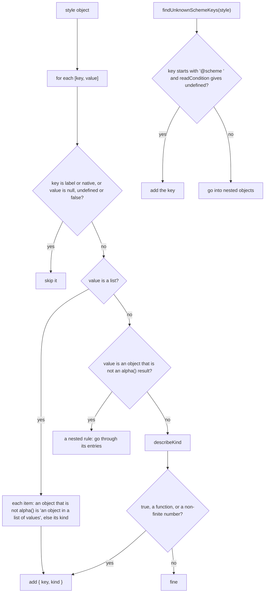

# findInvalidValues.ts

## What it does

Two checks on a style object before it is compiled. `findInvalidValues(style)` lists the declared values
that no CSS property can take: `true`, a function, a number that is not finite (`NaN`, `Infinity`) and an
object inside a list of values. `findUnknownSchemeKeys(style)` lists the keys that start with `@scheme ` and
name neither `light` nor `dark`. Both look into nested rules at any depth and change nothing.

## Why it exists

The serializer writes whatever it is given, so `width: true` or `'@scheme blue'` would become CSS that the
browser silently drops, or an at-rule no browser knows. The checks give the development warnings a name and
a reason for each. They are only for the development checks of a cache: `cache.ts` calls them when
`hasDevChecks` is on (`reportValues` and `reportGlobalValues`), and nothing else imports the file. It is
separate from `findUnsupportedDeclarations.ts` because it needs no browser: it judges the style object, not
the CSS text.

## The logic

## The data

An `InvalidValue` is `{ key, kind }`: the key as written (`width`, `backgroundColor`) and a description such
as `true`, `a function`, `NaN` or `an object in a list of values`. A scheme problem is the key itself.

## What it guarantees

- It only reports kinds that are never valid for any property. A word such as `light` is not reported:
  whether a property takes a word is the browser's to say (`findUnsupportedDeclarations`).
- `label` and `native` keys, and empty values (`null`, `undefined`, `false`), are never reported.
- An `alpha()` result is a valid value, as a single value and as a list item.
- It never throws and never changes the style.

## Decisions

- An object under a key is a nested rule, not an invalid value, so it is searched instead of reported.
- A key is skipped when it is `native`: the native part of a shared style is not written on the web.
- A scheme key is judged by `readCondition` of `scope.ts`, so the list of schemes lives in one place.

## Limits

- It cannot tell that a number is wrong for a property, or that a string is: only the three kinds above.
- `findUnknownSchemeKeys` does not look into lists (it skips arrays).
