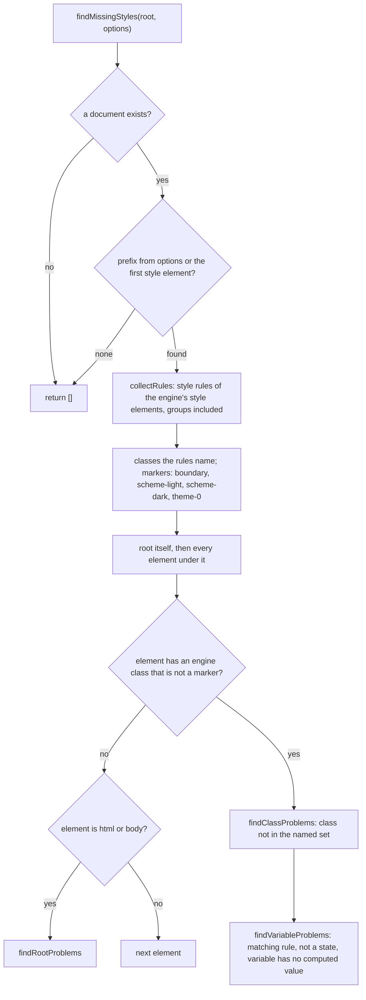

# findMissingStyles.ts

## What it does

`findMissingStyles(root?, options?)` inspects a live page and returns a list of `StyleProblem`s: a class of
the engine on an element that no rule names (`class-without-rule`), a variable that a matching rule uses
and the element has no value for (`variable-without-value`), and a global rule for `html`, `body` or
`:root` whose variables nothing above declares (`root-without-theme`). An empty list means nothing is
missing.

## Why it exists

A styled page can look wrong with no error: a class that was never inserted, or a theme that is not
applied above the element that uses its variables. The browser says nothing. This check reads the rules of
the engine's own style elements from the document and compares them with the elements and their computed
style. It is run by the dev checker of a cache (`devChecks.ts`), by the end-to-end tests
(`e2e/helpers/rules.ts` and the dev tests), and exported by `index.ts` for anyone who wants it.

The first lines of the file say it imports nothing at run time: the end-to-end tests send its compiled text
into a page, so the checker they run is the one the development mode runs.

## The logic



The rules are read from `style[data-style]`, `style[data-precedence]` (the ones React hoists) and
`style[data-umber]` elements of the prefix and of its `-global` set. For each rule the file keeps the
variables it uses without a fallback (`var(--prefix-x)`) and whether its selector is a state (`:hover`,
`:focus`, `:active`, `:focus-visible`, `:focus-within`). Rules for states are never checked.

## The data

```
{ kind: 'class-without-rule', name, element: 'div[card]', message, key: 'class:<name>' }
{ kind: 'variable-without-value', ..., key: 'variable:<name>:<selector>' }
{ kind: 'root-without-theme', ..., key: 'root:<selector>' }
```

`key` is what makes two problems the same one, so a warner can show each once.

## What it guarantees

- With no document or no engine style element, it returns `[]` (`findMissingStyles.node.test.ts`).
- A rule of another document (an iframe) is still read: a style rule is told by the name of its class, not
  by `instanceof`.
- A selector the browser cannot parse matches nothing and does not throw.
- A variable with a value from an ancestor is not a problem; only the computed value counts.
- It reads, and never writes, the page.

## Decisions

- Marker classes (`-boundary`, `-scheme-light`, `-scheme-dark`) and `-theme-0`, the theme class of a theme
  that declares nothing, have no rule by design and are left out.
- A root problem is one for each rule, with all its missing variables, because the cause is one rule.
- `options.prefix` wins over the prefix read from the page.

## Limits

- It reads the stylesheet through `element.sheet`; a style element with no sheet is ignored.
- It cannot see a rule that the page never inserted for an element it does not hold in the DOM yet.
