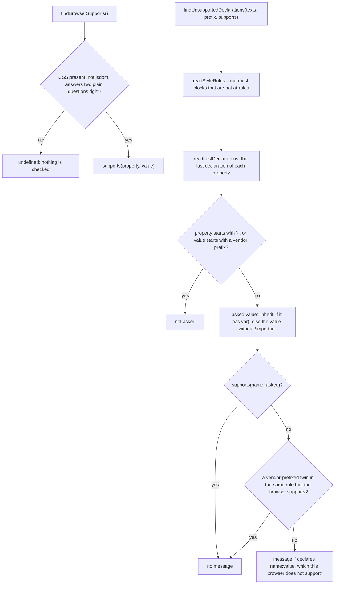

# findUnsupportedDeclarations.ts

## What it does

`findUnsupportedDeclarations(texts, prefix, supports, readLabel?)` takes the CSS text of rules an engine
wrote and returns a message for each declaration the browser does not support. `findBrowserSupports()`
gives the `supports` function (a wrapper of `CSS.supports`) or `undefined` where the browser cannot be
trusted. `describeClass(className, label)` names a class in a message, with the label of its component.

## Why it exists

A browser drops a declaration it does not understand without a word, so a typo in a property or a value
that the user's browser lacks leaves the page unstyled with no trace. In development the cache writes the
rules it inserts and, after a pause, asks the browser about each declaration. `devChecks.ts` holds the timer
and calls this file; `cache.ts` uses `describeClass` for its own messages.

## The logic

`readStyleRules` walks the text with a stack of blocks, skipping quoted strings; a block with no block
inside it and a prelude that does not start with `@` is a rule. `describeRule` names it: a `@keyframes`
rule by its name, otherwise the last class that starts with the prefix (with its label), otherwise
`the global rule <selector>`. At-rules with descriptors (`@property`, `@font-face`) are never asked about.

## The data

A message looks like `the class umber-x of "Button-root" declares colr:red, which this browser does not
support`. `StyleRuleText` is `{ selector, parent, body }`.

## What it guarantees

- Only the last declaration of a property in a rule is asked, because earlier ones in a fallback list are
  meant to be dropped.
- Custom properties and vendor-prefixed properties and values are never reported.
- A value with `var(` is judged by whether the browser knows the property (the value `inherit`).
- `!important` is not part of the question; the scan from the end of the value takes linear time.
- Where there is no usable `CSS.supports` (a server, jsdom, a browser that answers wrongly), the supports
  function is `undefined`.

## Decisions

- jsdom is excluded because it answers from a table of its own, not from what a browser renders.
- A standard property that the browser lacks is not reported when a supported vendor-prefixed form is in
  the same rule (`-webkit-user-select:none;user-select:none;` in Safari).
- Labels are written as given, capitals included.

## Limits

- It cannot judge a value that holds `var(`: it only checks that the property is known.
- A string with no closing quote makes `skipString` return past the end; the loops end there.
