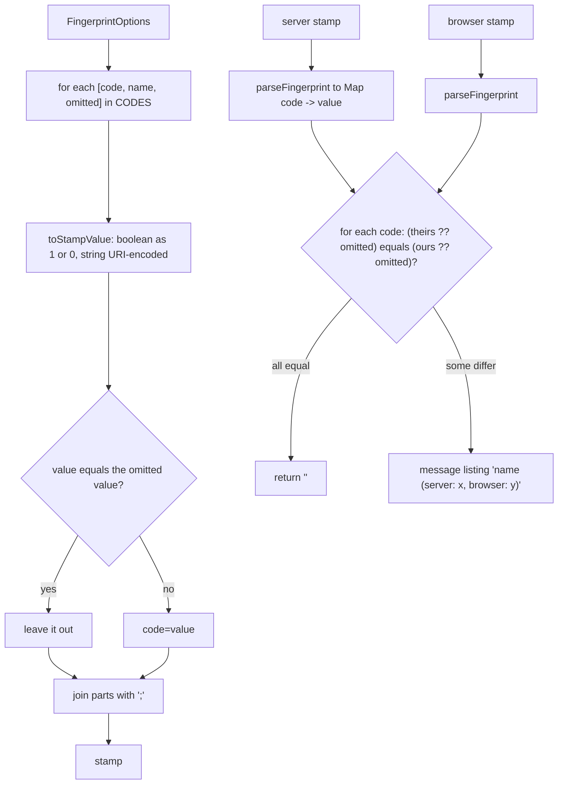

# fingerprint.ts

## What it does

`createFingerprint(options)` writes the options of a cache that change its output as one short text, such as
`p=umber;x=;l=1;y=1;r=1;b=1;s=1;f=1;t=`. `describeFingerprintDifferences(server, browser)` compares two such
texts and returns a message that names each option that differs with both values, or `''` when they agree.

## Why it exists

The server renders a page with one cache and the browser then makes its own. If their options differ (the
prefix, whether layers are used, whether pruning is on) the class names or the CSS differ, and the page
breaks in a way that is hard to trace. The server puts the stamp on its style element as `data-options`
(`extractStyles.ts`); a cache made in the browser reads that stamp (or a `<meta name="<prefix>-options">`)
and, when it differs from its own, throws an `Error` whose message names the options (`assertServerStamp`
in `cache.ts`). The stamp must be short enough for an attribute and must stay the same text for the same
options across releases, so it is its own small file.

## The logic



## The data

`CODES` is the ordered list of `[code, optionName, omittedValue?]`: `p` prefix, `x` suffix, `l` labels, `y`
layers, `r` pruning, `b` base class, `s` scope, `f` colour fallbacks, `v` value repair (omitted when `'0'`),
`w` vendor prefixes (omitted when `'1'`), `t` tokens (a hash). Examples from `fingerprint.test.ts`:

```
createFingerprint(base)                       -> 'p=umber;x=;l=1;y=1;r=1;b=1;s=1;f=1;t='
createFingerprint({ ...base, hasValueRepair: true }) -> 'p=umber;x=;l=1;y=1;r=1;b=1;s=1;f=1;v=1;t='
```

## What it guarantees

- The same options always give the same text; the order of the parts is the order of `CODES`.
- A string value is URI-encoded, so `;` and `=` in a suffix cannot break the parse.
- An option added later has an omitted value: a cache that leaves it at that value writes the same stamp as
  before the option existed, and a stamp that lacks it reads as that value.
- A stamp that lacks an option with no omitted value is reported as different (`hasScope (server: , ...)`).

## Decisions

- Options with an omitted value are left out of the stamp rather than written, to keep old stamps unchanged
  (the comment on `CODES`).
- The tokens are one hash (`tokens`), not a list, to keep the stamp short.

## Limits

- It compares text only; it cannot tell whether a difference matters for a given page.
- `parseFingerprint` does not validate a stamp: a part with no `=` is read with whatever `indexOf` gives.
