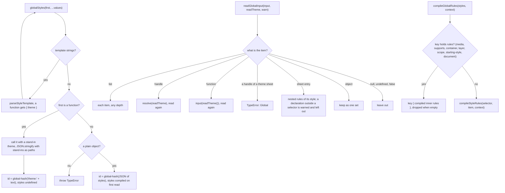

# globalStyles.ts

## What it does

`globalStyles(styles)` makes a handle for rules that are not a class: selectors (`body`, `html, body`) and
at-rules (`@media`, `@font-face`) as keys. The handle has an `id` made from the styles, a `resolve` that
gives the styles (calling a function of the theme only then), and `styles`, the CSS text. The file also
reads every form of global input an engine takes (`readGlobalInput`) and compiles global styles to flat
rules (`compileGlobalRules`).

## Why it exists

A class-based engine still needs rules for the page as a whole: a reset, the font of `body`, `@font-face`.
These must be definable in a module, before an engine or a theme exists, must be written once however many
times they are given, and must follow the theme when they are a function of it. A handle with an id from
the content gives all three. The file is separate from `serialize.ts` because it adds the global-specific
rules: the group at-rules, descriptors and the reading of `css()` values. It is used by `cache.ts`
(insertion), `createEngine.ts` (`insertGlobal`) and `index.ts` (exports `globalStyles` and its types).

## The logic

In `compileGlobalRules` a value that is a list writes the key once for each item, because an object cannot
hold one key twice. Each item is read through `readEntryStyle`, so a sheet entry stands for its style, and
a handle of a sheet made from a function of the theme is a `TypeError` that starts with `globalStyles()`.

## The data

A handle is frozen and branded with `Symbol.for('umber-style.global-styles')`. `GlobalStyleValue` is one of:
a style object, a sheet entry, a nested set of rules, at-rule descriptors, or a list of those.

## What it guarantees

- Nothing is written until an engine is given the handle; calling `globalStyles` has no side effect.
- The id depends on the styles alone, so equal styles give an equal id. A function of the theme is named by
  the tokens it reads (a stand-in theme), not by their values.
- `styles` is undefined for a function of the theme, whose rules need the theme of an engine; for an object
  it is built on first read and kept.
- Styles that are not an object (or a function) throw a `TypeError`, and so does a key that holds no style.
- An empty group at-rule writes nothing.
- A handle of a sheet made from a function of the theme (`sheet.card`), given as the styles of `Global` or
  under a key, is a `TypeError`: global styles have no provider to resolve it with.

## Decisions

- A `css()` value used as global styles gives its nested rules; its own declarations have no selector, so
  they are left out and reported through `warn`.
- Group at-rules are a fixed list (`GROUP_AT_RULE`); any other at-rule holds declarations.
- The text of `styles` uses the defaults of a cache (colour fallbacks on, value repair off, vendor
  prefixes on, default scoping) and no layer.

## Limits

- The id of an object is `JSON.stringify` of it, so a function inside a plain object is ignored by the id.
- A function of the theme cannot list the keys of the theme or pass a function to a helper (the stand-in
  throws, see `standIn.ts`).
