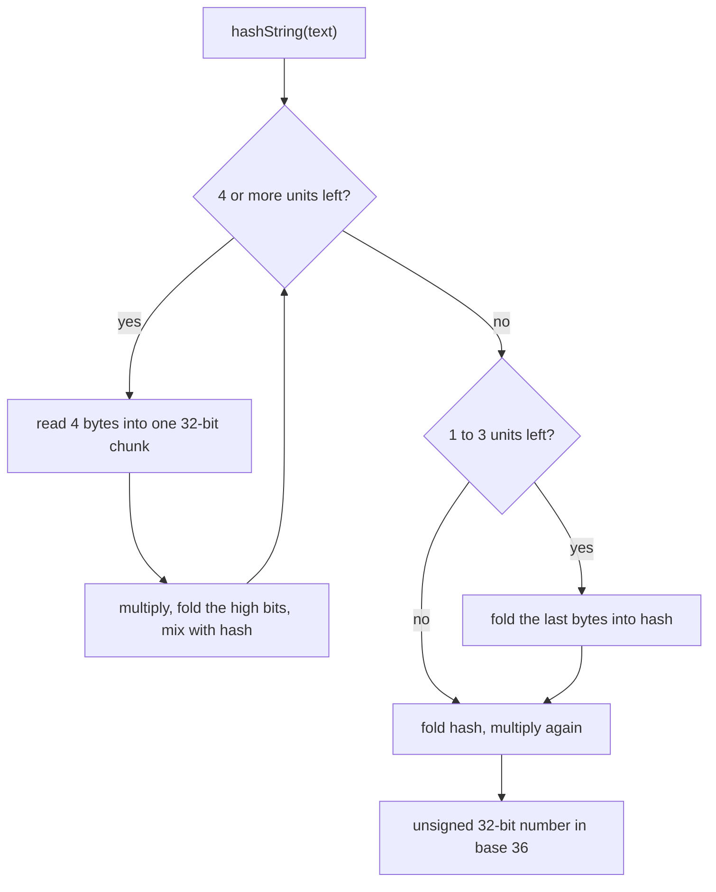

# hash.ts

## What it does

`hashString(text)` returns a short, stable hash of `text` in base 36. The same text gives the same hash in
every run.

## Why it exists

Class names, keys of rules and names of keyframes are made from the text of the rules, so the same style
gets the same name on the server and in the browser and is written once. The hash has no dependency, and it
must not change between releases or every generated name changes. It is used by `cache.ts`,
`createEngine.ts`, `globalStyles.ts`, `keyframes.ts` and `theme.ts`, and exported by `index.ts`.

## The logic

The loop reads four units at a time and mixes them with a multiplier (`0x5bd1e995`) kept to 32 bits by
`multiply`, which splits the product in two halves so that no step leaves the range of a double. The tail
of one to three units is folded in, then comes a final fold and one more multiply. The result is made
unsigned before `toString(36)`.

## What it guarantees

- It is deterministic and total: any string, a lone surrogate included, gives base 36 text.
- Values are pinned in `hash.test.ts` (`''` is `0`, `'a'` is `acqbnw`, `'color:red;'` is `tokvmb`), so a
  change of the algorithm fails a test.
- Each unit is read as a code point and reduced to its low byte.

## Decisions

- An astral character is hashed by its code point; the test records the old value, from UTF-16 units.
- The reason for this particular algorithm is not recorded in the code.

## Limits

- It is 32 bits wide and not cryptographic: two texts can collide, and nothing here detects it.
- Only the low byte of each character counts, so characters that differ only above bit 8 can hash alike.
