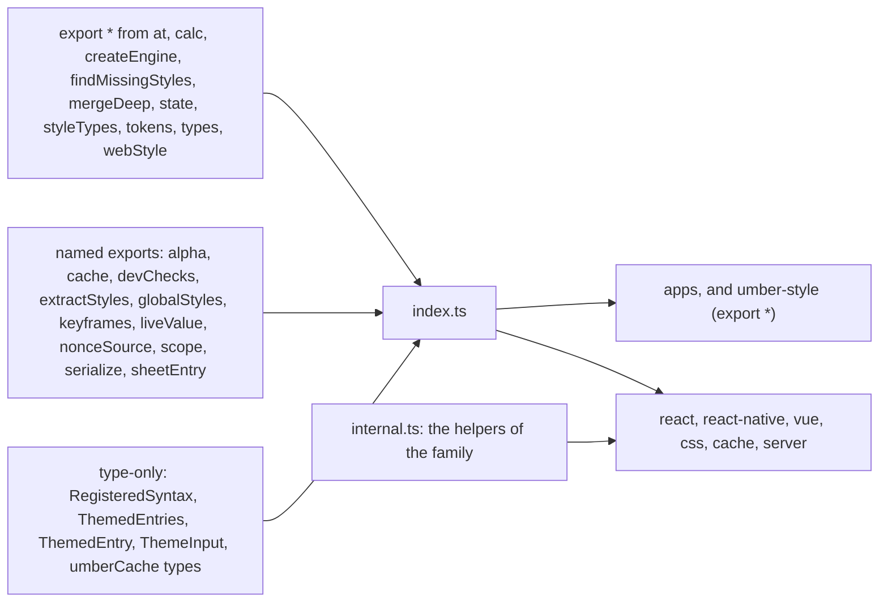

# index.ts

## What it does

The public entry of `@umber-style/core`: what an app uses. It re-exports the engine from the files of
`src/`: the engine factories, the cache and its sheets, the style and token types, the helpers (`alpha`,
`calc`, `at`, `mergeDeep`, `createTokens`), the state keys (`state`, `readState`, `STATE_SELECTORS`), the
page extraction (`createStyleTag`, `extractPageStyles`, `extractPageStyleParts`), the development checks,
`keyframes`, `globalStyles`, the serializer (`compileRules`, `mergeStyles`, `readLabel`,
`DEFAULT_SCOPING`), the tests for an alpha colour, a live value, a sheet entry and a function sheet, and
`setNonceSource`. It holds no logic of its own.

## Why it exists

`packages/packages.md` keeps the public API in `index.ts`, so a consumer imports from one place and the
files behind it can be split or renamed. The umbrella `umber-style` re-exports this entry whole, so every
name here is API of two packages. What only the bindings and the other packages of the family use is in
`internal.ts` (`@umber-style/core/internal`) instead: before 0.8.0 most of it was here too, reachable
by apps by accident (issue #79).

## The logic

## What it guarantees

- Only the names listed here are public. A name moves out of here only when no page of `docs/` shows
  an app using it and every importer in the repository is a package of the family.
- `index.test.ts` pins the surface, and compares every value exported with the table of
  `docs/plain-javascript.md`, which must list each one once and nothing else. `internal.test.ts` pins
  the other entry and checks that the two share no name.
- Files that are API as a whole are exported with `export *`; a file that also holds helpers of the
  bindings (`alpha`, `cache`, `extractStyles`, `liveValue`, `nonceSource`, `scope`, `sheetEntry`,
  `themedEntry`, `themeInput`) is exported by name, so its helpers stay in `internal.ts`.

## Decisions

- A name with evidence both ways stays here: `extractPageStyleParts` (only `@umber-style/server`
  imports it, but it is the two-part form of `extractPageStyles`), `isDevelopment` (benchmarks outside
  the repository read it of each core), `findMissingStyles` and `findMissingPaths` (the development
  checks, named as the checker of the core in `docs/testing.md`), `readState` and `STATE_SELECTORS` (in
  the row of `state`), `DEFAULT_SCOPING` (the default of an argument of `compileRules`), and the tests
  `isAlphaColor`, `isLiveValue`, `isSheetEntry`, `isThemedSheet`, with `findEntryCache`, which the page
  of plain JavaScript shows.
- Type-only exports use `export type`, so the file adds nothing at run time for them.

## Limits

- The exports are in the alphabetical order of their files. The order of the lines does not decide when
  a file is evaluated for the files that others import first: `templateStyle.ts`, for example, is loaded
  through `cache.ts` and `keyframes.ts`, and is not exported here at all.
