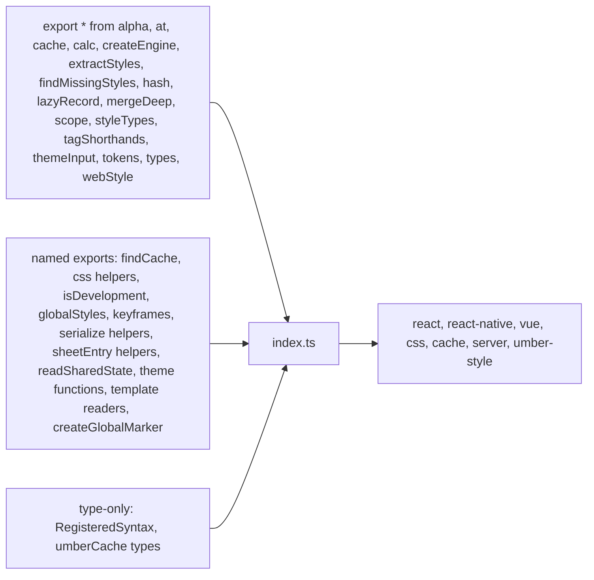

# index.ts

## What it does

The public entry of `@umber-style/core`. It re-exports the engine from the files of `src/`: the cache, the
engine factory, the style and token types, the helpers (`alpha`, `calc`, `at`, `hash`, `mergeDeep`, lazy
records), the page extraction, `keyframes`, `globalStyles`, the theme functions and the template readers.
It holds no logic of its own.

## Why it exists

`packages/packages.md` keeps the public API in `index.ts`, so a consumer imports from one place and the
files behind it can be split or renamed. Some files are exported whole (`export *`), others by name, so
that internal helpers stay private.

## The logic

## What it guarantees

- Only the names listed here are public; a file that is not exported (`findInvalidValues.ts`,
  `fingerprint.ts`, `referenceKeys.ts`, `codeAt.ts`, `cacheRegistry.ts` apart from `findCache`) is internal.
- Of `devChecks.ts` only `isDevelopment` is exported; of `css.ts` five functions; of `serialize.ts` four
  names and two types.
- `index.test.ts` pins the surface.

## Decisions

- Wide `export *` for files that are API as a whole (`calc`, `tokens`, `types`), named exports for files with
  internals next to their API (`css`, `globalStyles`, `keyframes`, `serialize`, `theme`).
- Type-only exports use `export type`, so the file adds nothing at run time for them.

## Limits

- The last export line (`templateStyle`) is out of the alphabetical order of the rest; the code does not
  say whether that is on purpose.
