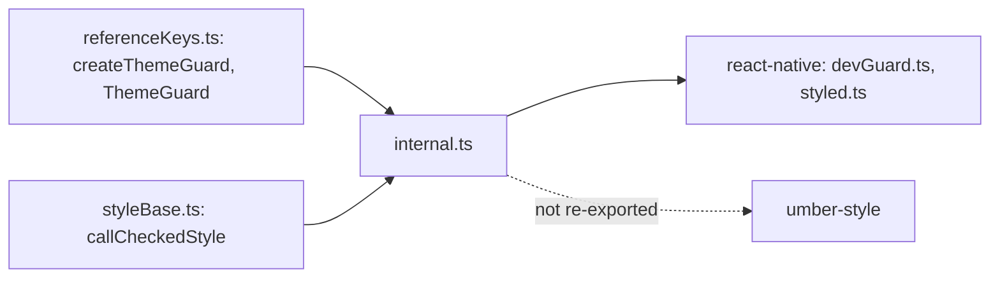

# internal.ts

## What it does

The entry `@umber-style/core/internal`. It re-exports the helpers that a binding needs from the engine
and an app never does: `createThemeGuard` (with its type `ThemeGuard`) from `referenceKeys.ts`, and
`callCheckedStyle` from `styleBase.ts`. Today the one user is the React Native binding, for its
development checks (`devGuard.ts`, `styled.ts`).

## Why it exists

These names were in the main entry, which is the public surface of the package and is listed name by
name in `docs/plain-javascript.md`. Helpers for one binding do not belong in what an app reads. A second
entry keeps them importable across packages without presenting them as API.

## What it does not promise

Nothing between releases: a name here may change shape or go in any version, a patch included. The
umbrella `umber-style` does not re-export this entry, and `index.ts` does not export these names.

## One copy

The build has two entries over one set of modules (`tsdown.config.ts`), so the bundler puts the shared
modules in a common chunk and both entries import it: no module state is duplicated.

## The logic

