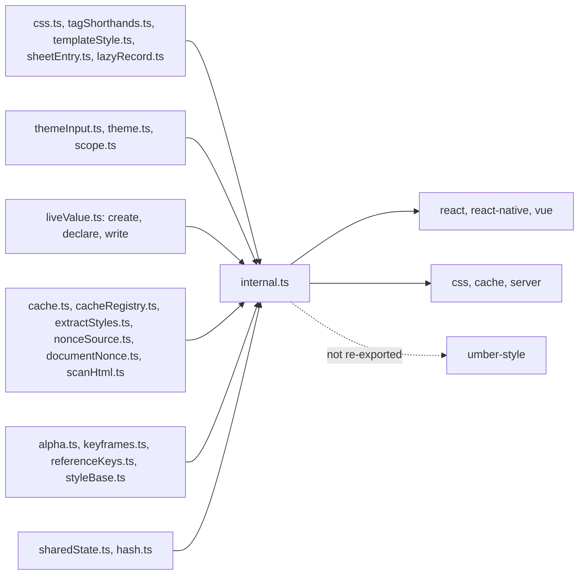

# internal.ts

## What it does

The entry `@umber-style/core/internal`. It re-exports what the bindings (React client and server builds,
React Native, Vue) and the other packages of the family (`css`, `cache`, `server`) need from the engine
and an app never does:

- the parts of `css()` and `styled` of a web binding (`css.ts`, `tagShorthands.ts`, `templateStyle.ts`),
  the sheet entries as a binding makes and flattens them (`sheetEntry.ts`), and the lazy records of the
  default style (`lazyRecord.ts`);
- the providers: the theme a provider adds and the theme below it (`themeInput.ts`, with
  `EMPTY_THEME`), the names and rules of the theme classes a provider writes itself (`theme.ts`), and the
  pieces of theme conditions (`scope.ts`, with the type `Condition`);
- `useStyleValue`: making, declaring and writing a live value (`liveValue.ts`, with the type
  `LiveRule`);
- server rendering and the page: the selector of the style elements (`cache.ts`), the cache of a prefix
  in a document (`cacheRegistry.ts`), the nonce attribute, the nonce source as read back and the page's
  nonce (`extractStyles.ts`, `nonceSource.ts`, `documentNonce.ts`), and the marker of a `Global`
  (`scanHtml.ts`);
- what React Native shares: `toRgba` and `assertAlphaInput` (`alpha.ts`), `readKeyframesSteps`
  (`keyframes.ts`), and its development checks, `createThemeGuard` (`referenceKeys.ts`) and
  `callCheckedStyle` (`styleBase.ts`);
- `readSharedState` (`sharedState.ts`) and `hashString` (`hash.ts`).

## Why it exists

These names were in the main entry, which is the public surface of the package, re-exported whole by
the umbrella `umber-style`, and listed name by name in `docs/plain-javascript.md`. Helpers for the
bindings do not belong in what an app reads. A second entry keeps them importable across packages
without presenting them as API. 0.7.0 moved the first three here (#69); 0.8.0 moved the rest (#79).

## What it does not promise

Nothing between releases: a name here may change shape or go in any version, a patch included. The
umbrella `umber-style` does not re-export this entry, and `index.ts` does not export these names
(`internal.test.ts` checks that the two entries share none).

## What is here and is used by nothing

Some names are here because they are the pieces of a part that moved, not because a package imports
them: `createThemeClass`, `getBoundaryClass`, `getSchemeClass`, `createScopeRule`,
`createNoSchemeGuard`, `isTemplateStrings` and `readEntrySource` have no importer outside the core.

## One copy

The build has two entries over one set of modules (`tsdown.config.ts`), so the bundler puts the shared
modules in a common chunk and both entries import it: no module state is duplicated.

## The logic

