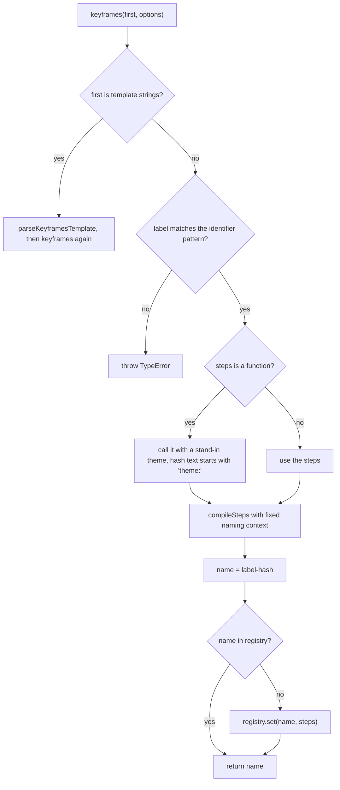

# keyframes.ts

## What it does

`keyframes(steps, options?)` registers an animation and returns its name, `<label>-<hash>`, at once. Nothing
is written to a sheet then. The rest of the file lets the cache use the registry: `isKeyframesName`,
`createKeyframesRule` (the `@keyframes` text of a name) and `findAnimationNames` (which registered names the
`animation` and `animation-name` declarations of some compiled rules use).

## Why it exists

An animation is a global rule that a class refers to by name. The name has to be known when the style is
written, long before any theme or engine may exist, and the same steps must give the same name on the
server, in the browser and in every engine of the process. So the name is a hash of the steps alone, the
steps go into a registry, and the rule is written only when a class that names the animation is inserted.
`cache.ts` finds the names in the rules it writes and asks for the rule; `createEngine.ts`, `styleTypes.ts`
and `templateStyle.ts` use the name and types; `index.ts` exports `keyframes` and its types.

## The logic

`compileSteps` calls `normalizeSteps` first: each key is split on commas, `from` is 0 and `to` is 100, an
offset must be a percentage from 0% to 100%, steps of one offset are merged with the later winning, and the
result is sorted. A stand-in value is turned into its path, and a nested style in a step throws a
`TypeError`. Later, `createKeyframesRule(name, readTheme, context)` compiles the registered steps again with
the cache's own context, reading the real theme only for a function.

`findAnimationNames(rules)` scans compiled rules for `animation` at the start of a declaration (after `{` or
`;`), takes the value up to the next `;`, and keeps each word that is a registered name, once.

## The data

The registry is a `Map<name, KeyframesInput>` under the shared name `core.keyframes@1`, so every copy of the
core in the process reads one registry. The naming context is fixed: colour fallbacks on, value repair off,
default scoping, so a name does not change with the options of an engine.

## What it guarantees

- Equal steps give the same name; `from`/`to`, a comma list and the order of keys are the same steps.
- A function of the theme is named by the tokens it reads, not by their values (it sees a stand-in theme).
- Nothing is read from the registry in `findAnimationNames` while no name is registered.
- Matching is by whole identifier, in nested selectors and at-rules too.

## Decisions

- The hash is of the steps alone, so it does not depend on the theme, the prefix or token options.
- A themed function is hashed with a `theme:` prefix, so it cannot collide with equal literal steps.
- The registry is kept for the process: an engine made later knows names made before it.

## Limits

- A step holds declarations only; a selector or at-rule in it throws.
- `findAnimationNames` expects each declaration to end with `;` (the doc comment). A rule whose `animation`
  value has no closing `;` makes `indexOf(';', start)` return -1, which the loop does not guard against.
