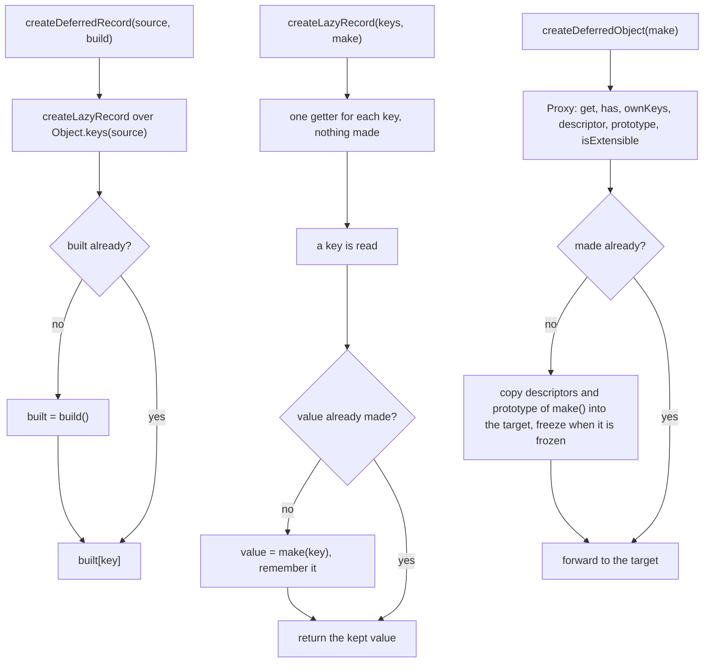

# lazyRecord.ts

## What it does

Three helpers that delay work until a value is read. `createLazyRecord(keys, make)` returns a frozen object
with one key for each of `keys`, whose value is made on the first read and kept. `createDeferredRecord(source,
build)` is the same for the keys of `source`, with every value taken from one record that `build` makes when
the first key is read. `createDeferredObject(make)` returns a Proxy that stands for the object `make`
returns, made on the first use of any kind.

## Why it exists

A sheet or a default style is defined at module level, before the engine it needs may exist (before
`configure` is called) or before a platform call may run. The helpers let the names exist now and the work
happen later. Without them a module that defines a style would force an engine at import time. `createEngine.ts`
uses `createLazyRecord` for the entries of a sheet, `index.ts` exports all three, and
`packages/react/src/defaultStyle.ts` and `defaultStyle.server.ts` use `createDeferredRecord` and
`createDeferredObject`.

## The logic

Each trap of the Proxy calls `ensure()` first, then forwards to the real target with `Reflect`. A frozen
result freezes the target after the copy.

## The data

The record has the same keys as `keys` (or `Object.keys(source)`), each enumerable with a getter and no
setter. The deferred object starts as `{}` and takes the descriptors and the prototype of what `make`
returned.

## What it guarantees

- Nothing is made until a key is read (or, for the object, until it is used); each value is made once.
  A value that is `undefined` is kept and not made again (`lazyRecord.test.ts`).
- The record is frozen; `Object.keys` and a spread list the keys, and a spread reads every one.
- `build` runs once, when the first key is read.
- When `make` throws in the deferred object, nothing is marked made, so the next use tries again.
- The deferred object stays extensible when what it stands for is, and keeps its prototype.

## Decisions

- The deferred object is a Proxy over an empty target, with six traps, so that every kind of use
  (a read, `in`, a key listing, a frozen check) triggers the build. The code does not say why other traps
  are left out.
- The record uses getters on a frozen object, so a key cannot be replaced after the object is made.

## Limits

- The Proxy traps do not cover writes or deletes: the test file shows only reads and checks. A write goes
  to the target without making the object first.
