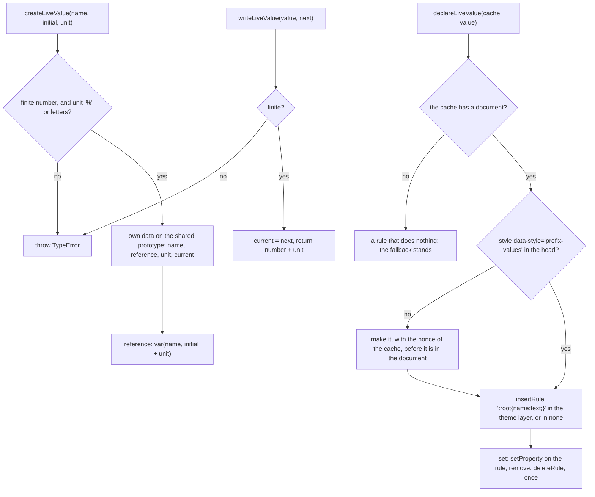

# liveValue.ts

## What it does

The engine side of `useStyleValue`: a value that a style reads through a CSS variable, and the rule that
declares the variable in a document. `createLiveValue(name, initial, unit?)` makes the value,
`writeLiveValue(value, next)` gives it a new number and returns the text to declare, `declareLiveValue(cache,
value)` writes the rule and returns what changes it in place (`set`) and takes it away (`remove`), and
`isLiveValue` tells a value apart. `calc.ts` reads a value as an operand.

## Why it exists

A number that changes on every frame, given to a component as a plain object in `style`, is a class for
each number: one rule written and one removed for each change, and a render for each. A variable lets the
class be written once: the class reads `var(--<prefix>-value-<id>)`, and a change is one declaration set
in place, with no render and no new rule. The bindings (`useStyleValue.ts` of React and of Vue) own the
lifecycle; what both need, the value and the rule, is here, with no framework.

## The logic

## The data

- A value is an object made from one prototype, `LIVE_PROTOTYPE`, that every value shares: it carries
  `get()` (the number now), `toString()` (the reference) and a brand, `Symbol.for('umber-style.live-value')`,
  so that a value made by another copy of the core is told apart too. Its own keys are data only: `name`
  (`--<prefix>-value-<id>`), `reference`, `unit` and `current`. Making a value makes no function; two values
  share one `get` (the test `holds its data only...`).
- The reference is `var(<name>, <initial><unit>)`, fixed when the value is made: the class that uses it is
  the same whatever the value holds, and with no rule the first number is in effect.
- The rule is `:root{<name>:<text>;}`, wrapped as `@layer <prefix>-theme{...}` when the cache has layers.
  The handle keeps the browser's object of that rule: the inner style rule for `set`, the outer one for
  `remove`, found by its place at that time.

## What it guarantees

- A change (`set`) is one `setProperty` on one rule: no rule is inserted or removed, nothing is parsed.
- The rule goes into a style element of its own, `data-style="<prefix>-values"`, written only with
  `insertRule`: the cache's own element may be written with text nodes, and the two ways of writing never
  share an element (`cache.ts`). The cache does not read this element as a page element (its selector names
  `data-style="<prefix>"` exactly).
- The element is made in the document of the cache (an iframe's, for a cache whose sheet is there), with
  the cache's nonce set before it is in the document.
- The selector is `:root`, not `:where(:root)`: the cache removes the `:where(:root)` rules that a page sent
  when it declares its own root theme (`scanStyleText.ts`), and a value's rule must not be one of them.
- `remove` twice does nothing, and a rule that something else deleted first is left as it is.

## Decisions

- The first number is the fallback of the reference instead of a rule that a server sends: a server
  renders many requests with one cache, and a rule there would be named after a tree position that two
  requests share. The fallback is in the class, which every way of server rendering sends already.
- The variable holds the number as the engine writes a number for any custom property, with no unit, unless
  the value is given one. A unit could not be inferred from the property, because the variable is declared
  apart from the rules that read it.
- The rule is in the theme layer, where the other declarations of variables are.
- Rejected: changing the text of a text node of the cache's element (it parses the whole element again),
  and a `style` attribute (the engine renders none on the web).

## Limits

- Without a document (a server) there is no rule: `set` and `remove` do nothing.
- A name is unique only as far as the binding makes it so (a hash of a `useId`).
- A value is not reactive in any framework: what rendered from `get()` does not render again.
